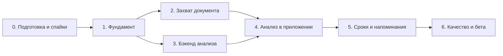

# Навигатор по документам: план имплементации MVP

Основан на [SPEC.md](./SPEC.md) v0.30. Ссылки вида CAP-2 и §7.3 ведут к требованиям и разделам спецификации, D-1…D-6 — к решениям из SPEC §11.1 (D-1, D-4 и D-5 приняты, D-2, D-3 и D-6 ещё нет).

## Состояние на 2026-10-19

| Этап                   | Готово                                                           | Осталось                                                                                                                                                                         |
| ---------------------- | ---------------------------------------------------------------- | -------------------------------------------------------------------------------------------------------------------------------------------------------------------------------- |
| 0. Подготовка и спайки | 0.1, 0.2; 0.4, 0.5 и 0.7 на Android                              | 0.6: 20 синтетических документов — для 0.3 хватает, к 3.7 нужно 30–50, обезличенные реальные и юридические случаи (SPEC §7.6). 0.3 не начата; iOS-части 0.4, 0.5 и 0.7           |
| 1. Фундамент           | 1.0–1.9                                                          | —                                                                                                                                                                                |
| 2. Захват документа    | 2.1–2.6, перестановка страниц (CAP-6)                            | Перетаскивание на iOS не проверено                                                                                                                                               |
| 3. Бэкенд анализа      | 3.1, 3.3, 3.4, 3.5 — на `MockLlmProvider` и счётчиках в памяти   | 3.2 и 3.7 ждут 0.3; 3.6 ждёт план Starter и базу Upstash; 3.8 ничего не ждёт                                                                                                     |
| 4. Анализ в приложении | 4.1, 4.2, 4.4, 4.5 — в тестах, web-превью и на эмуляторе Android | Задачи 4.3, 4.6, 4.7; плавность списка из 100+ документов — на preview-сборке телефона; `keepScreenAwake()` проверяется только в preview-сборке                                  |
| 5. Сроки и напоминания | 5.1–5.5 — в тестах и на эмуляторе Android                        | 5.6; напоминания на iOS и после перезагрузки телефона не проверены; заполненная форма «В календарь» — на устройстве с аккаунтом в календаре, iOS-часть 5.5 — в первой iOS-сборке |
| 6. Качество и бета     | —                                                                | Всё                                                                                                                                                                              |

`npm run verify` проходит: 73 набора, 941 тест. Удалённый репозиторий подключён (`origin` на GitHub, `main` отправлен), задачи по-прежнему коммитятся прямо в `main`, без PR; прошёл ли там CI из задачи 1.9, отсюда не проверить (`gh` не авторизован). На iOS не проверено ничего.

**Критический путь к M1:** 0.3 → 3.2. Набор для 0.3 готов (0.6), сравнение ждёт ключей провайдеров (см. «Что нужно от вас»). Задачу 3.6 можно начать на `MockLlmProvider`, не дожидаясь 3.2: проверить Upstash, страницу Logs и путь «устройство → preview», а ключ LLM добавить после 3.2. Клиентские задачи этапов 4 и 5 от критического пути не зависят и идут на моке.

**Что делать дальше, без внешних зависимостей:**

1. ~~Пересобрать Android dev build и прогнать [`docs/smoke-test.md`](./smoke-test.md).~~ Сделано на эмуляторе, прогон записан. Найдены и исправлены две ошибки, которых не видели Jest и web-превью: отправка файлов анализа (`expo/fetch`) и миниатюры «Оригинала». Сканер ML Kit на эмуляторе сейчас не открывается (Google Play services), шаги 2 и 5 — на телефоне.
2. ~~0.6: дополнить набор до 20–30 размеченных документов.~~ Сделано: 20 документов, 34 случая анализа (`scripts/eval/synthetic/all_kits.py`).
3. ~~5.2: `planReminders()` — чистые функции без новых зависимостей.~~ Сделано, `syncReminders()` ждёт 5.1.
4. ~~4.5: главный экран — «Требует внимания», поиск, пустое состояние.~~ Сделано в тестах и web-превью; на эмуляторе и с 100+ документами ещё не проверено.
5. ~~4.4: редактирование срока, переименование, удаление и переанализ (ANL-8).~~ Сделано в тестах и web-превью; нативный дата-пикер и меню на эмуляторе ещё не проверены.
6. ~~Прогнать на эмуляторе Android 4.4 и 4.5 и дописать шаги в [`docs/smoke-test.md`](./smoke-test.md).~~ Сделано: шаги 30–43, 120 документов засевает `scripts/smoke/seed-android-documents.mjs`. Найдены и исправлены две ошибки (сохранение названия при открытой клавиатуре, переанализ без файлов страниц). Список на эмуляторе с development build тяжелее статичного экрана (90-й процентиль кадра 32 мс против 19), пустых мест нет — плавность проверяется на preview-сборке телефона.
7. ~~Перестановка страниц (CAP-6).~~ Сделано: удержание и перетаскивание с прокруткой у края (`react-native-gesture-handler` и Reanimated из шаблона, новых зависимостей нет), действия для экранного диктора. Проверено в тестах, в web-превью и на эмуляторе Android (шаги 44–46 [`docs/smoke-test.md`](./smoke-test.md)); на iOS не проверено.
8. ~~3.8: даты вычисленных сроков считает сервер по правилу из текста (SPEC §7.3, §7.4, правило 3).~~ Сделано: чистая функция в пост-обработке, проверена в тестах на `MockLlmProvider`. Черновик правовой памятки по Германии из 3.9 можно писать сейчас.
9. ~~5.3: переход по уведомлению к документу (REM-6).~~ Сделано: проверено в тестах и на эмуляторе Android — из фона, при холодном старте и без повтора после перезапуска (шаги 58–60 [`docs/smoke-test.md`](./smoke-test.md)).
10. ~~5.4: вкладка «Сроки» (REM-1, US-9, US-12).~~ Сделано: проверено в тестах, на эмуляторе Android (шаги 61–64) и в web-превью.
11. ~~5.5: «В календарь» (REM-10).~~ Сделано: проверено в тестах и на эмуляторе Android (шаги 65–70 [`docs/smoke-test.md`](./smoke-test.md)), разрешений календаря в сборке нет. Заполненную форму на эмуляторе не увидеть: Google Calendar без аккаунта Google открывает вход в аккаунт — нужен телефон или эмулятор с аккаунтом в календаре (шаги 65 и 67).

**Что делать после вашего согласия или решения:**

12. 4.3 — после согласия на `expo-sharing`.
13. 0.3 → 3.2 → 3.7, как только есть ключи провайдеров: набор готов. Для открытых моделей (SPEC D-6) хватит аккаунта Scaleway Generative APIs. По итогам 0.3 — решения D-3 и D-6, затем 4.6: текст согласия зависит от D-3, текст о хранении — от D-2.
14. 3.6 — как только есть план Starter и база Upstash; затем веха M1 на устройстве.
15. Первая iOS-сборка через EAS — до M2, иначе iOS-части спайков 0.4 и 0.7 (VisionKit, календарь на iOS 16, `Intl` в Hermes) и «В календарь» из 5.5 всплывут только на бете.
16. 3.9 — вычитка правовой памятки юристом до беты (SPEC §11.2, вопрос 13).

## Принципы

- **Сначала сквозной сценарий на заглушке.** `MockLlmProvider` позволяет собрать путь «скан → анализ → экран документа → напоминание» до выбора реального LLM-провайдера.
- **Одна задача — один PR.** Каждая задача заканчивается зелёным `npm run verify` и тестами рядом с кодом.
- **Проектные скиллы.** `new-feature`, `new-screen`, `new-component`, `api-integration`, `add-dependency`, `write-tests` описывают соглашения репозитория. Колонка «Скилл» в таблицах указывает, какой из них использовать. Скиллы приведены к архитектуре в задаче 1.0. Где скилл расходится с AGENTS.md или SPEC, правы они, а скилл исправляется.
- **Решения до кода.** Задача, которая зависит от решения D-x, не начинается, пока решение не принято и не перенесено в SPEC.
- **Чистая логика отдельно от платформы.** Расчёт напоминаний, обработку дат и валидацию ответа пишем как чистые функции с unit-тестами. Нативные модули (сканер, уведомления, календарь) прячем за тонкими адаптерами с `.web.ts`-заглушками.
- **Платные и публичные действия только с подтверждения:** `eas build`, `eas deploy`, `eas submit`, `eas update`, установка зависимостей.

## Целевая структура кода

```
src/
  app/                          маршруты (тонкие) + API routes
    (tabs)/index.tsx, deadlines.tsx, settings.tsx
    capture/_layout.tsx, index.tsx, review.tsx   свой стек в одной модалке захвата
    documents/[id].tsx, documents/[id]/pages.tsx
    onboarding.tsx
    api/v1/analyze+api.ts, limits+api.ts, metrics+api.ts
  features/
    capture/                    сканер, выбор фото и файла, нормализация, экран проверки
    documents/                  список, экран документа и блоки результата
    analysis/                   запрос анализа, мутация, сохранение результата, панель статуса
    deadlines/                  мутации сроков (с 4.2), вкладка «Сроки», редактирование срока
    reminders/                  planReminders(), syncReminders(), адаптер уведомлений
    onboarding/                 онбординг и согласие
    settings/                   настройки
  lib/
    db/                         открытие SQLite, миграции, репозитории, ключи запросов
    files/                      хранение файлов документа
    i18n/                       настройка локализации, словари ru/en
    device-id.ts, network.ts
    api/client.ts               + поддержка FormData и таймаута, заголовки клиента
  shared/                       чистый TS без React/RN/Expo (клиент + сервер)
    analysis/                   zod-схема AnalysisResult, контракт ответа, JSON Schema, фикстуры
    limits.ts                   30 страниц, 20 МБ, 10 анализов в день
    limits-contract.ts, api-headers.ts, calendar-date.ts, explanation-locales.ts
  server/                       ТОЛЬКО для src/app/api/**/*+api.ts
    analysis/                   обработчик, промпт, провайдеры (mock, <provider>), пост-обработка
    http/                       ошибки, заголовки клиента и IP, multipart
    limits/                     лимиты и бюджет
    store/                      счётчики: в памяти и Upstash
    logs/, metrics/, privacy/   логи без содержимого, отчёт беты, псевдонимы
    testing/                    построители запросов и PDF для тестов
scripts/eval/                   оценка качества анализа на тестовом наборе
docs/smoke-test.md              ручной чек-лист нативных сценариев
```

**Зависимости между модулями:**

- Вся работа с БД идёт через `src/lib/db`: репозитории и ключи запросов для таблиц `documents`, `pages`, `deadlines`, `actions`, `settings`. Фичи не открывают БД сами и не лезут в таблицы друг друга.
- Фичи могут импортировать друг у друга компоненты и явно выделенные функции (например, `syncReminders()` из `features/reminders`), но без циклов. Ожидаемое направление: `documents → analysis → reminders`, `deadlines → reminders`, `settings → reminders`. Циклы ловит линтер (задача 1.7).
- `src/shared` не импортирует React, React Native и Expo. `src/server` импортируется только из `src/app/api/**`.

## Этапы



Этапы 2 и 3 можно вести параллельно: их связывает только общая схема из задачи 1.2. Чистую логику напоминаний (задача 5.2) можно начать сразу после этапа 1.

Размеры задач: **S** — до 1 дня, **M** — 1–3 дня, **L** — 3–5 дней.

### Этап 0. Подготовка и снятие рисков

Цель: до основной разработки проверить самые рискованные допущения (хостинг, сканер, качество LLM, платформенные API) и принять решения D-1…D-6. Номера задач сохранены из первой версии плана; новые задачи 0.6 и 0.7 стоят в таблице в порядке запуска.

| #   | Задача                                                                                                                                                                                                                                                                                                                                                                                                                                                                                                                                                                                                                                                                                                                                          | Результат / критерий приёмки                                                                                                                                                                                                                                                                                                                                                                                                                                                                                                       | Скилл             | Размер |
| --- | ----------------------------------------------------------------------------------------------------------------------------------------------------------------------------------------------------------------------------------------------------------------------------------------------------------------------------------------------------------------------------------------------------------------------------------------------------------------------------------------------------------------------------------------------------------------------------------------------------------------------------------------------------------------------------------------------------------------------------------------------- | ---------------------------------------------------------------------------------------------------------------------------------------------------------------------------------------------------------------------------------------------------------------------------------------------------------------------------------------------------------------------------------------------------------------------------------------------------------------------------------------------------------------------------------- | ----------------- | ------ |
| 0.1 | Закрыть открытые вопросы 1–4 из SPEC §11.2 и вопрос 11 (OTA). Прописать `ios.bundleIdentifier`, `android.package` и схему deep link в `app.json`. Принять решения D-4 и D-5, они не требуют спайков.                                                                                                                                                                                                                                                                                                                                                                                                                                                                                                                                            | Идентификаторы заданы, D-4 и D-5 перенесены в SPEC. **Сделано** (SPEC v0.3).                                                                                                                                                                                                                                                                                                                                                                                                                                                       | —                 | S      |
| 0.6 | **Тестовый набор документов (стартует первым, критический путь для 0.3).** Назначить ответственного, сгенерировать синтетические и собрать обезличенные документы (SPEC §7.6), включая мошеннические письма и документы с текстом, адресованным модели. Разметить эталонные сроки, риски и признаки мошенничества. Хранилище вне git, если есть персональные данные.                                                                                                                                                                                                                                                                                                                                                                            | 20–30 размеченных документов к началу 0.3, 30–50 к этапу 3. **Готово для 0.3:** `scripts/eval/synthetic/all_kits.py` собирает 20 синтетических документов (de 11, en 5, ru 4: договоры, счета, письма ведомств, банк, страховка; 5 мошеннических, 2 с текстом, адресованным модели), 34 случая анализа, включая сканы и плохие фото, граничные файлы CAP-3, CAP-7, CAP-8, ANL-7. Даты от `--today`, эталон в `labels.json` (формат в `scripts/eval/README.md`). К этапу 3: 30–50 документов, обезличенные реальные, ответственный. | —                 | L      |
| 0.2 | Спайк EAS Hosting: тестовый `+api.ts` принимает `multipart/form-data` на 20 МБ и ждёт внешний ответ 60 с. Деплой в preview. Замерить пиковую память изолята на 20 МБ (лимит Workers 128 МБ). Проверить, видит ли обработчик обрыв соединения клиентом и что происходит с исходящим запросом после обрыва (для D-1 и возврата лимита).                                                                                                                                                                                                                                                                                                                                                                                                           | Замеры задержки, памяти и лимитов. Решение D-1. Лимит размера подтверждён или снижен. Синхронный запрос подходит, или выбран запасной вариант (стриминг, асинхронная задача, отдельный сервис). **Сделано:** [отчёт](spikes/0.2-eas-hosting.md). Синхронный запрос подходит, 20 МБ проходят; риск — память при параллельных запросах (см. 3.1).                                                                                                                                                                                    | `api-integration` | M      |
| 0.3 | Сравнение LLM: черновик промпта (SPEC §7.4) и схемы (§7.3), набор из 0.6. Кандидаты (SPEC D-6): открытые модели через API в ЕС — Qwen3.6-35B-A3B, Qwen3.8-27B, Gemma 4 31B (PDF для них растеризует сам скрипт) — и 1–2 закрытых провайдера с приёмом PDF. Обязательные условия: данные не используются для обучения, есть DPA, файлы принимаются inline без Files API, лицензия открытых весов допускает использование в ЕС (§7.5). Проверить, что схема проходит ограничения structured output у каждого кандидата; у Qwen — с режимом рассуждения и без. Лучше после 3.8: тогда даты вычисленных сроков меряются так, как их будет считать сервер. Скрипт сравнения пишется сразу как минимальная версия `scripts/eval/` (её развивает 3.7). | Отчёт по метрикам §7.6 (с задержкой p95), выбранный провайдер и модель, стоимость документа (для вопроса 12 §11.2). Решения D-3 и D-6, черновик текста ONB-2. **Не начато:** ждёт ключей провайдеров; для открытых моделей хватит аккаунта Scaleway Generative APIs (первый миллион токенов бесплатно).                                                                                                                                                                                                                            | —                 | L      |
| 0.4 | Спайк сканера: `react-native-document-scanner-plugin` и форк `@preeternal/react-native-document-scanner-plugin` в development build на Android с RN 0.88 и New Architecture                                                                                                                                                                                                                                                                                                                                                                                                                                                                                                                                                                     | Многостраничный скан работает. Если нет, выбран запасной вариант (см. риски). **Android сделано:** [отчёт](spikes/0.4-scanner.md), выбран `react-native-document-scanner-plugin` 2.0.4, форк запасной. iOS — в первой сборке EAS.                                                                                                                                                                                                                                                                                                  | `add-dependency`  | M      |
| 0.7 | Спайк платформенных API в development build: (1) «В календарь» на Android — нужен ли `READ_CALENDAR` для `getCalendars()` + `addEventWithForm()`, работает ли Intent `ACTION_INSERT` (REM-10); (2) `Intl.PluralRules` и `Intl.DateTimeFormat` с `timeZone` в Hermes (§8.5); (3) если для D-2 выбран A или C — как исключить файлы из бэкапа iOS и Android; (4) «В календарь» на iOS 16, где нет доступа только на запись.                                                                                                                                                                                                                                                                                                                       | Короткий отчёт с выводами, перенесёнными в SPEC §9 и REM-10. Решение D-2 (вместе с юридической вычиткой, задача 6.4). **Android (1, 2) сделано:** [отчёт](spikes/0.7-platform-apis.md). (4) и `Intl` на iOS — в первой iOS-сборке, (3) — если D-2 = A или C.                                                                                                                                                                                                                                                                       | `add-dependency`  | S      |
| 0.5 | Development build: `expo-dev-client`, локально `npx expo run:android`, для iOS сборка через EAS. `eas init`, `expo-updates` с `runtimeVersion: { policy: 'fingerprint' }` (SPEC §1.5).                                                                                                                                                                                                                                                                                                                                                                                                                                                                                                                                                          | Сборки для разработки на обеих платформах. **Android сделано:** локальная сборка на эмуляторе с Google Play (`ANDROID_HOME=~/Android/Sdk npx expo run:android`), dev client грузит бандл из Metro. iOS — одной сборкой EAS после спайков 0.4 и 0.7, нужен платный Apple Developer Program.                                                                                                                                                                                                                                         | `run-app`         | S      |

**Когда принимаются решения:**

| Решение                                 | Когда                       | На основании                             |
| --------------------------------------- | --------------------------- | ---------------------------------------- |
| D-4 PDF на клиенте, D-5 язык объяснений | Приняты в задаче 0.1: A и B | Рекомендации SPEC §11.1                  |
| D-1 Анализ в фоне                       | Принято после 0.2: A        | Замеры спайка                            |
| D-3 Обещание о хранении                 | После 0.3                   | Условия выбранного провайдера            |
| D-6 Где работает модель, PDF            | После 0.3, вместе с D-3     | Отчёт 0.3: качество, задержка, стоимость |
| D-2 Резервные копии                     | После 0.7, не позже 6.4     | Спайк и юридическая вычитка              |

### Этап 1. Фундамент

| #   | Задача                                                                                                                                                                                                                                                                                                                                                                                                                                                                                                                                                                        | Результат / критерий приёмки                                                                                                                                                                                                                                                                                                                                                                                                                                 | Скилл             | Размер |
| --- | ----------------------------------------------------------------------------------------------------------------------------------------------------------------------------------------------------------------------------------------------------------------------------------------------------------------------------------------------------------------------------------------------------------------------------------------------------------------------------------------------------------------------------------------------------------------------------- | ------------------------------------------------------------------------------------------------------------------------------------------------------------------------------------------------------------------------------------------------------------------------------------------------------------------------------------------------------------------------------------------------------------------------------------------------------------ | ----------------- | ------ |
| 1.0 | Соглашения под новую архитектуру. AGENTS.md уже обновлён (SPEC v0.2). Обновить скиллы `api-integration`, `new-feature`, `new-screen`, `write-tests`: локальные данные через репозитории `src/lib/db` и React Query, API routes и тесты обработчиков в `src/server`, правила зависимостей между фичами, i18n для строк. README описывает продукт, а не шаблон.                                                                                                                                                                                                                 | Скиллы и README не противоречат AGENTS.md и SPEC. **Сделано:** обновлены 10 скиллов из 12 (в `verify` и `performance-audit` противоречий не было), README описывает продукт.                                                                                                                                                                                                                                                                                 | —                 | S      |
| 1.1 | Локализация: `expo-localization`, библиотека i18n, словари `ru` и `en`, перевод существующих строк (вкладки, `screen-state`, настройки), множественное число по правилам языка с полифилом `Intl.PluralRules` (спайк 0.7: в Hermes на Android его нет)                                                                                                                                                                                                                                                                                                                        | Язык переключается, строк без перевода не осталось. Тест хука перевода и русских форм множественного числа. **Сделано:** `i18next` + `react-i18next` с типизированными ключами (`src/lib/i18n`), выбор языка в настройках (SET-1, «Как в системе» по умолчанию), даты через `Intl` в языке интерфейса, переведён и запрос камеры iOS. Проверено на эмуляторе Android и в web-превью; iOS-часть — только по файлам prebuild.                                  | `add-dependency`  | M      |
| 1.2 | Общий код `src/shared/`: zod-схема `AnalysisResult` (включая `fraudSignals` и границы длин), схема ответа `{ analysis, pageCount }` (SPEC §7.2), типы, список языков объяснений, лимиты (30 страниц, 20 МБ или значение из 0.2), 5 фикстур (счёт, письмо от ведомства, договор, мошеннический счёт, нечитаемый документ)                                                                                                                                                                                                                                                      | Фикстуры проходят валидацию, из схемы генерируется JSON Schema, совместимая с выбранным провайдером. Тесты. **Сделано:** `zod` 4, `src/shared/analysis/` (схема, контракт ответа и коды ошибок, `toLlmJsonSchema()`, 5 фикстур), `limits.ts`, `explanation-locales.ts`; типы в `src/lib/db` сужены до схемы. Провайдер ещё не выбран (0.3), поэтому JSON Schema — общее подмножество кандидатов (SPEC §7.3), проверка на выбранном провайдере — в 0.3 и 3.2. | `write-tests`     | S      |
| 1.3 | БД `src/lib/db/`: `expo-sqlite`, миграции, таблицы из SPEC §6.2, репозитории документов, страниц, сроков, действий и настроек. **До начала кода** выбрать подход: (а) свои репозитории с async-интерфейсом и in-memory реализацией того же интерфейса для Jest или (б) Drizzle ORM. Колонка `search_text` (HOME-3), затирание содержимого при удалении (STO-6), ключ `explanation_locale` (D-5). Web: настроить wasm в Metro и заголовки COOP/COEP (SPEC §9) или подключить in-memory реализацию, чтобы web-превью продолжало работать. Сплэш держится до окончания миграций. | Миграции идемпотентны, CRUD с мягким удалением, поиск находит кириллицу без учёта регистра, web-превью открывается. **Сделано:** вариант (а) — свои репозитории, тесты на SQLite в памяти через `node:sqlite` вместо in-memory подделки; версия схемы в `PRAGMA user_version`. Проверено на эмуляторе Android и в web-превью.                                                                                                                                | `new-feature`     | L      |
| 1.4 | Файлы `src/lib/files/`: сохранение страниц в `Paths.document/documents/<id>/`, относительные пути, удаление документа и всех данных, обработка отсутствующего файла (STO-8)                                                                                                                                                                                                                                                                                                                                                                                                   | Файлы переживают перезапуск, в БД нет абсолютных путей, отсутствующий файл не роняет экран. **Сделано:** `src/lib/files/page-files.ts` (+ `.web.ts` в памяти), пути только `documents/<id>/<file>`; проверено на эмуляторе. Показ «Оригинал недоступен» — в 4.2.                                                                                                                                                                                             | —                 | S      |
| 1.5 | `deviceId`: генерация через `expo-crypto`, хранение в `expo-secure-store`                                                                                                                                                                                                                                                                                                                                                                                                                                                                                                     | Стабилен между запусками. **Сделано:** `src/lib/device-id.ts` (+ хранилище `.web.ts` через `localStorage`), проверено на эмуляторе после перезапуска.                                                                                                                                                                                                                                                                                                        | —                 | S      |
| 1.6 | Переделка фичи `documents`: `api.ts` и `queries.ts` читают из репозиториев `src/lib/db` вместо HTTP и фикстур. Для локальных запросов `staleTime: Infinity`, без повторов и без обновления при возврате в приложение, инвалидация после записи. Сетевые настройки `createQueryClient` остаются только для запросов к API.                                                                                                                                                                                                                                                     | Список и экран документа работают на данных из SQLite, тесты обновлены. **Сделано:** HTTP и фикстуры убраны (заодно строка «API: Local fixtures» в настройках), проверено на эмуляторе и в web-превью.                                                                                                                                                                                                                                                       | `api-integration` | M      |
| 1.7 | ESLint: `@/server/*` разрешено импортировать только из `src/app/api/**`. `src/shared/**` не импортирует `react`, `react-native`, `expo*`. `import/no-cycle` для `src/features/**`.                                                                                                                                                                                                                                                                                                                                                                                            | Линтер падает на запрещённый импорт и на цикл между фичами. **Сделано:** правила в `eslint.config.js` (плюс `src/server` без кода приложения и Expo, кроме `expo-server`, и запрет hex-литералов вне темы); проверено временными файлами-нарушителями.                                                                                                                                                                                                       | —                 | S      |
| 1.8 | Чистка шаблона и тема: убрать ссылку «Docs» из web-вкладок, фикстуры «Getting started», строку «API: Local fixtures»; в `ThemedText` убрать hex-литерал `linkPrimary` (контраст ~3,5:1 на белом не проходит AA); убрать неиспользуемые `lightColor`/`darkColor` из `ThemedView`; добавить токены цветов для уровней риска и предупреждения о мошенничестве с контрастом AA в обеих темах                                                                                                                                                                                      | В компонентах нет hex-литералов, контраст токенов проверен. **Сделано:** ссылка «Docs» убрана (фикстуры и «Local fixtures» — ещё в 1.6), `linkPrimary` берёт `tint`, светлый `tint` затемнён до AA на карточках, токены риска и мошенничества; контраст проверяет `src/constants/theme.test.ts`.                                                                                                                                                             | `new-component`   | S      |
| 1.9 | CI: шаг `npx expo export` (web, включая API routes, и android), чтобы ловить ошибки сборки бандла, которые не видят `tsc` и Jest. Проверка, что имена серверных переменных (`LLM_*`) не встречаются в клиентском бандле. Согласовать ветку: workflow слушает `master`, а основной на GitHub может быть `main`.                                                                                                                                                                                                                                                                | CI падает при сломанном бандле и при утечке секрета в клиент. **Сделано:** job `bundle` с `npm run check:bundle` (`scripts/check-client-bundle.mjs`), CI слушает `master` и `main`; утечка поймана и в web, и в байткоде Hermes.                                                                                                                                                                                                                             | —                 | S      |

### Этап 2. Захват документа

| #   | Задача                                                                                                                                                                                                              | Результат / критерий приёмки                                                                                                                                                                                                                                                                                                                                                                                                                                                                                                                                                                                                                                                                                                                                                                                                                                                                                                                                                                                                                                                                                                                                                                                                   | Скилл            | Размер |
| --- | ------------------------------------------------------------------------------------------------------------------------------------------------------------------------------------------------------------------- | ------------------------------------------------------------------------------------------------------------------------------------------------------------------------------------------------------------------------------------------------------------------------------------------------------------------------------------------------------------------------------------------------------------------------------------------------------------------------------------------------------------------------------------------------------------------------------------------------------------------------------------------------------------------------------------------------------------------------------------------------------------------------------------------------------------------------------------------------------------------------------------------------------------------------------------------------------------------------------------------------------------------------------------------------------------------------------------------------------------------------------------------------------------------------------------------------------------------------------ | ---------------- | ------ |
| 2.1 | Модальный маршрут `capture/index` и кнопка «+» на главном экране (CAP-1)                                                                                                                                            | Открывается выбор источника: «Сканировать», «Фото из галереи», «Файл». Router-тест. **Сделано:** кнопка «Добавить» в шапке списка (не прокручивается вместе с ним), `capture/_layout.tsx` — свой стек в одной модалке для выбора источника и проверки страниц (2.5), «Отмена». Варианты выключены, пока нет сканера (2.2) и выбора файлов (2.3). Проверено на эмуляторе Android и в web-превью.                                                                                                                                                                                                                                                                                                                                                                                                                                                                                                                                                                                                                                                                                                                                                                                                                                | `new-screen`     | S      |
| 2.2 | Адаптер сканера, config plugin с текстом разрешения камеры (CAP-2, CAP-9). По итогам спайка 0.4: защита от двойного запуска, быстрая «отмена» как признак недоступного сканера, проверка числа страниц после скана. | Многостраничный скан возвращает пути к изображениям. Отмена обрабатывается. **Сделано:** адаптер `features/capture/scanner.ts` (+ `.web.ts`), защита от двойного запуска, «отмена» быстрее 1 с → подсказка про галерею и файлы (CAP-9), лимит страниц сканеру и проверка после скана (CAP-7); текст разрешения камеры был с 0.4 и 1.1. Страницы живут в сессии модалки захвата, экран `capture/review` уже показывает миниатюры (остальное — в 2.5). На эмуляторе сканер ML Kit теперь открывается: скан → проверка и отмена проверены. Недоступный сканер — только в тестах, iOS не проверен.                                                                                                                                                                                                                                                                                                                                                                                                                                                                                                                                                                                                                                 | `add-dependency` | M      |
| 2.3 | Выбор файла через `expo-document-picker` и фото через `expo-image-picker`, проверка типа и размера (CAP-3, CAP-7). Для PDF клиент проверяет только тип и размер, остальное сервер (D-4).                            | PDF и изображения принимаются, неподходящие файлы отклоняются с понятным текстом. **Сделано:** адаптер `features/capture/pickers.ts` (галерея — несколько фото в порядке выбора, до 30 страниц; «Файл» — один PDF или изображение) с защитой от двойного запуска; чистая проверка `picked-files.ts`: формат по MIME или расширению (HEIF = HEIC, WebP и прочее отклоняются), число страниц, размер PDF ≤ 20 МБ (неизвестный размер проверит сервер). Размер изображений проверяется после нормализации (2.4). PDF на `capture/review` уже показан иконкой, именем и размером (часть 2.5). На Android заблокированы CAMERA и RECORD_AUDIO из `expo-image-picker`, на iOS убран текст микрофона и переведён текст доступа к фото. Проверено на эмуляторе Android (фото-пикер без разрешений, «Файлы» → PDF) и в web-превью; iOS не проверен, восстановление выбора после убийства Activity (`getPendingResultAsync`) не обрабатывается.                                                                                                                                                                                                                                                                                          | `add-dependency` | S      |
| 2.4 | Нормализация изображений через `expo-image-manipulator` (CAP-4) и проверка суммарного размера после неё (CAP-7)                                                                                                     | JPEG, длинная сторона ≤ 2048 px, HEIC → JPEG. Страница весит примерно 300–600 КБ. **Сделано:** адаптер `features/capture/normalize-image.ts` (уменьшение уже при декодировании через `maxWidth`/`maxHeight`, JPEG 0.8, освобождение нативных объектов); `prepare-pages.ts` готовит страницы по одной сразу после скана или выбора, с прогрессом и отменой при закрытии модалки, затем проверяет суммарный размер — единственная проверка размера, и для PDF. Нечитаемое изображение — понятная ошибка. Проверено на эмуляторе Android (фото 4032×3024 с поворотом по EXIF → JPEG 1536×2048 в правильной ориентации) и в web-превью (PNG 3000×4000 → JPEG 1536×2048); iOS и HEIC на устройстве не проверены.                                                                                                                                                                                                                                                                                                                                                                                                                                                                                                                    | `add-dependency` | S      |
| 2.5 | Экран проверки `capture/review`: миниатюры, удаление, «Доснять ещё», сохранение черновика в БД и файлы. Для PDF иконка файла, имя и размер (CAP-5, D-4).                                                            | После «Разобрать документ» создаётся документ `draft` и открывается его экран. **Сделано:** миниатюры с кнопкой удаления, «Доснять ещё» (сканер) или «Добавить ещё фото» (галерея) с лимитами на весь документ — общий хук `use-capture-pages.ts` для обоих экранов захвата; `saveDraft()` в `features/capture/api.ts` копирует файлы в папку документа и создаёт документ со страницами одной транзакцией (`documents.create(input, pages)`), при ошибке удаляет скопированное; экран документа заменяет модалку, «Назад» ведёт к списку. Проверено на эмуляторе Android (скан → «Доснять ещё» → черновик из 2 страниц, файлы в `Paths.document`) и в web-превью (удаление, добавление, сохранение). Перестановка страниц (CAP-6) сделана позже, после 4.5: `components/page-grid.tsx` — сетка с удержанием (300 мс) и перетаскиванием на `react-native-gesture-handler` v3 и Reanimated, прокрутка у края кадр за кадром, геометрия и порядок — чистые функции в `page-grid-layout.ts`; действия «Переместить раньше/дальше» для экранного диктора; `GestureHandlerRootView` в корне приложения и в тестовых провайдерах. Страница стоит через `left`/`top`, а не `transform`: иначе Android даёт TalkBack неверные границы. | `new-screen`     | M      |
| 2.6 | Web: без кнопки сканера (`.web.tsx`, CAP-10)                                                                                                                                                                        | Web-сборка не падает, выбор фото и файла работают. **Сделано:** вместо отдельного `.web.tsx` экрана — флаг `SCANNER_SUPPORTED` в адаптере сканера (`false` в `scanner.web.ts`), экран выбора на web показывает только «Фото из галереи» и «Файл». Проверено в web-превью; экспорт web и Android (`check:bundle`) проходит.                                                                                                                                                                                                                                                                                                                                                                                                                                                                                                                                                                                                                                                                                                                                                                                                                                                                                                     | —                | S      |

### Этап 3. Бэкенд анализа

| #   | Задача                                                                                                                                                                                                                                                                                                                                                                                                                                                                     | Результат / критерий приёмки                                                                                                                                                                                                                                                                                                                                                                                                                                                                                                                                                                                                                                                                                                                                                                                           | Скилл             | Размер |
| --- | -------------------------------------------------------------------------------------------------------------------------------------------------------------------------------------------------------------------------------------------------------------------------------------------------------------------------------------------------------------------------------------------------------------------------------------------------------------------------- | ---------------------------------------------------------------------------------------------------------------------------------------------------------------------------------------------------------------------------------------------------------------------------------------------------------------------------------------------------------------------------------------------------------------------------------------------------------------------------------------------------------------------------------------------------------------------------------------------------------------------------------------------------------------------------------------------------------------------------------------------------------------------------------------------------------------------- | ----------------- | ------ |
| 3.1 | Каркас `POST /api/v1/analyze`: тонкий `+api.ts` → `src/server/analysis/handle-analyze.ts`, разбор `request.formData()`, валидация, коды ошибок SPEC §7.2 (включая `426 upgrade_required` и `422 invalid_pdf`), разбор PDF до вызова модели: число страниц, пароль, повреждение (D-4, `pdf-lib` или аналог), `MockLlmProvider`. В памяти не больше трёх размеров файла: не держать `File` и `ArrayBuffer` после кодирования, отпускать ссылки до вызова модели (SPEC §7.1). | Тесты обработчика на `Request` и `Response` для всех кодов ошибок. Замер на preview, как в спайке 0.2: 4 одновременных запроса по 20 МБ проходят, иначе лимит снижается до 10 МБ. **Сделано:** `src/server/http/` (тело §7.2, заголовки клиента и проверка версии, разбор multipart с пределом в 20 МБ + 64 КБ), `src/server/analysis/` (обработчик, `inspectPdf()` на `pdf-lib`, `LlmProvider`, `MockLlmProvider` с выбором фикстуры и задержкой, заготовка пост-обработки для 3.3), общие имена полей и заголовков в `src/shared`. Любой зашифрованный PDF — `encrypted_pdf`. Проверено на наборе 0.6 локально и на preview. Замер ([отчёт](spikes/0.2-eas-hosting.md#повторный-замер-в-задаче-31)): 4 × 20 МБ проходят, ошибок памяти нет, лимит 20 МБ остаётся; но на Free срабатывает лимит CPU (`504`), см. 3.6. | `api-integration` | M      |
| 3.2 | Реализация выбранного провайдера: промпт с правилами §7.4 (включая признаки мошенничества, защиту от инструкций в тексте документа и правовую памятку из 3.9 в начале промпта), structured output с полем `rule` (§7.3), одна повторная попытка при невалидном ответе. Если по D-6 выбран B или C — сервис растеризации PDF в ЕС, который ничего не хранит                                                                                                                 | Фикстурные документы дают валидный `AnalysisResult`, мошеннический документ даёт непустой `fraudSignals`. Провайдер опустошает переданный массив файлов после кодирования; замер 3.1 повторён с настоящим кодированием (base64, тело запроса): 4 × 20 МБ проходят. **Ждёт 0.3 и D-6.** **Сделано для своего сервера (D-6, промежуточное решение, 2026-10-20):** `OpenAiCompatibleProvider` (structured output по `toLlmJsonSchema()`, одна повторная попытка по `checkShape`, коды ошибок), промпт с правилами §7.4 1–10 без памятки 3.9, растеризация PDF сервисом `pdf-render`; модель Ollama `qwen3.6:35b` в `deploy/compose.yaml`. Осталось: памятка 3.9 в промпте, проверка на фикстурных документах с настоящей моделью, замер 4 × 20 МБ на Workers.                                                             | `api-integration` | M      |
| 3.3 | Пост-обработка: формат и диапазон дат (в том числе при `documentDate = null`), ссылки `deadlineId`, обрезка по границам схемы (SPEC §7.4)                                                                                                                                                                                                                                                                                                                                  | Unit-тесты на граничные случаи. **Сделано:** `postProcessAnalysis()` в `src/server/analysis/` (правила в SPEC §7.4), `finalizeAnalysis()` сначала проверяет форму ответа схемой `llmAnalysisShapeSchema` — она строится той же функцией, что и строгая схема, JSON Schema для модели не изменилась; даты `YYYY-MM-DD` в `src/shared/calendar-date.ts` (пригодятся в 5.2). Тесты: каждое правило, граница диапазона в оба направления, 29 февраля, фикстуры проходят без изменений.                                                                                                                                                                                                                                                                                                                                     | `write-tests`     | S      |
| 3.4 | Лимиты: счётчики по `deviceId` и IP (щадящий порог из-за CGNAT), общий дневной бюджет, `GET /api/v1/limits`, списание из лимита после ответа модели: обрыв клиентом сервер не видит, обработчик отменяется (спайк 0.2, SPEC §8.3). Хранилище — Upstash Redis в ЕС (выбрано 2026-10-18, SPEC §8.3), там же дневные счётчики метрик из 3.5.                                                                                                                                  | `429` с `Retry-After`, `503` при исчерпании бюджета. Тесты с фейковым хранилищем. **Сделано:** `src/server/store/` (интерфейс счётчиков в терминах Redis, хранилище в памяти, клиент Upstash REST на `fetch`), `src/server/limits/` (`AnalysisUsage`: 10 анализов в сутки UTC на устройство со списанием только за `200`, 60 попыток в час с IP, бюджет `DAILY_BUDGET_USD`, fail open с `limits.unavailable`; `GET /api/v1/limits`), дневные счётчики метрик из 3.5 и закрытый `GET /api/v1/metrics` по `METRICS_TOKEN` (`src/server/metrics/`), общие зависимости маршрутов `createServerDeps()`. Проверено тестами и на dev-сервере (лимит, `429` с `Retry-After`, `GET /limits`, отчёт). С настоящим Upstash не проверено: база ещё не создана (3.6).                                                               | `api-integration` | M      |
| 3.5 | Логи и метрики: только метаданные (задержка, токены, стоимость, код ошибки), без содержимого. Серверные метрики беты из SPEC §8.7.                                                                                                                                                                                                                                                                                                                                         | Проверено, что содержимое документа не попадает в логи. Метрики §8.7 со стороны сервера видны. **Сделано (логи):** события `analyze.start` и `analyze.end` с метаданными (`src/server/logs/`, формат в SPEC §7.1), хэш `deviceId` через HMAC (`src/server/privacy/`), сбои без текста сообщения, `costUsd` от провайдера. Тест прогоняет запросы и проверяет, что ни одна строка анализа, имя файла и `deviceId` не попали в логи. Дневные счётчики метрик и отчёт `GET /api/v1/metrics` сделаны в 3.4. **Осталось:** что события видны на странице Logs деплоя, проверяется в 3.6.                                                                                                                                                                                                                                    | —                 | S      |
| 3.6 | Деплой preview на EAS Hosting: секреты через EAS environment variables (ключ LLM, `DEVICE_ID_HASH_KEY`, `UPSTASH_REDIS_REST_URL` и `_TOKEN` от базы в ЕС, `METRICS_TOKEN`, `DAILY_BUDGET_USD`), `origin` для нативного приложения, разные URL и ключи для development, preview и production                                                                                                                                                                                | Dev build на устройстве получает анализ от preview-сервера. До этого план EAS Hosting переведён на Starter: на Free лимит CPU 10 мс обрывает запросы на 20 МБ (замер 3.1, требует согласия — платно). События `analyze.start` и `analyze.end` видны на странице Logs деплоя и находятся по `Cf-Ray` на Requests (3.5). Лимиты и отчёт метрик работают на Upstash. Деплой можно проверить на `MockLlmProvider` до 3.2, ключ LLM добавляется после неё. **Ждёт:** план Starter и базу Upstash в ЕС. Альтернатива без них — свой сервер в Docker Compose (`deploy/`, вместе с моделью до публичного релиза): ждёт доступа к серверу.                                                                                                                                                                                      | —                 | S      |
| 3.7 | `scripts/eval/`: развитие скрипта из 0.3 — прогон набора через любой `LlmProvider`, отчёт по метрикам SPEC §7.6, включая точность вычисленных дат и сроки позже настоящего. Набор дополнен юридическими случаями §7.6 с эталоном, проверенным юристом                                                                                                                                                                                                                      | Воспроизводимый отчёт одной командой. **Ждёт 0.3.**                                                                                                                                                                                                                                                                                                                                                                                                                                                                                                                                                                                                                                                                                                                                                                    | —                 | M      |
| 3.8 | Даты вычисленных сроков на сервере (SPEC §7.3, §7.4, правило 3): поле `rule` в JSON Schema для модели и в `llmAnalysisShapeSchema`, расчёт даты в пост-обработке (начало отсчёта, дни, недели, месяцы с переносом на последний день месяца, `before`, `endOf`), `rule` не уходит клиенту. `MockLlmProvider` отдаёт сроки с `rule`                                                                                                                                          | Unit-тесты: каждый вариант `from`, `after` и `before`, 31-е число + месяц, 29 февраля, `endOf`, нет даты начала — отсчёт от `today` и `confidence: 'low'`, неполное правило — дата модели и `low`, посчитанная дата вне диапазона отбрасывается. Клиентская схема `AnalysisResult` и сохранённые анализы не меняются. Не ждёт 0.3. **Сделано:** `rule` есть в `llmAnalysisSchema` и `llmAnalysisShapeSchema`, клиентскую `analysisResultSchema` та же функция строит без него. Дату считает `deadlineDate()` в `src/server/analysis/deadline-date.ts` до проверки диапазона, `addMonths()` и `endOfPeriod()` — в `src/shared/calendar-date.ts`. `MockLlmProvider` отдаёт `llmOutputFixture()` с правилами, после пост-обработки ответ совпадает с `ANALYSIS_FIXTURES`.                                                 | `write-tests`     | S      |
| 3.9 | Правовая памятка по Германии (SPEC §7.4, правило 11): термины, от какого события идут сроки, типичные сроки по типам документов — простым языком, до 20 тыс. токенов, текстом в `src/server/analysis/` под версиями                                                                                                                                                                                                                                                        | Памятка вычитана юристом (SPEC §11.2, вопрос 13), подключена в промпт 3.2, юридические случаи набора проходят пороги §7.6. Черновик пишется сейчас, вычитка — до беты                                                                                                                                                                                                                                                                                                                                                                                                                                                                                                                                                                                                                                                  | —                 | M      |

### Этап 4. Анализ в приложении

| #   | Задача                                                                                                                                                                                                                                                                                                                                                                                                                                                                                                                                          | Результат / критерий приёмки                                                                                                                                                                                                                                                                                                                                                                                                                                                                                                                                                                                                                                                                                                                                                                                                                                                                                                                                                                                                                                                                                                                                                                                                                                                                                                                                                                                                                                                                                                                                                                                                                                                                                                                                                                                                                                                                                                                                                                                                                                                                                              | Скилл             | Размер |
| --- | ----------------------------------------------------------------------------------------------------------------------------------------------------------------------------------------------------------------------------------------------------------------------------------------------------------------------------------------------------------------------------------------------------------------------------------------------------------------------------------------------------------------------------------------------- | ------------------------------------------------------------------------------------------------------------------------------------------------------------------------------------------------------------------------------------------------------------------------------------------------------------------------------------------------------------------------------------------------------------------------------------------------------------------------------------------------------------------------------------------------------------------------------------------------------------------------------------------------------------------------------------------------------------------------------------------------------------------------------------------------------------------------------------------------------------------------------------------------------------------------------------------------------------------------------------------------------------------------------------------------------------------------------------------------------------------------------------------------------------------------------------------------------------------------------------------------------------------------------------------------------------------------------------------------------------------------------------------------------------------------------------------------------------------------------------------------------------------------------------------------------------------------------------------------------------------------------------------------------------------------------------------------------------------------------------------------------------------------------------------------------------------------------------------------------------------------------------------------------------------------------------------------------------------------------------------------------------------------------------------------------------------------------------------------------------------------- | ----------------- | ------ |
| 4.1 | `features/analysis`: `apiClient` с поддержкой `FormData` и таймаута 90 с, мутация `analyzeDocument` (без повторов), статусы документа (SPEC §6.3), сохранение `analysis`, `pageCount`, `search_text` и нормализация сроков и действий в БД, `interrupted` при старте (ANL-4). Перевод ошибок в коды SPEC §7.2 в одном месте, проверка сети через `expo-network`. Поведение в фоне (D-1, вариант A): `expo-keep-awake`, пока идёт хотя бы один анализ, подсказка «Не сворачивайте приложение», при обрыве статус `failed` и «Повторить» (ANL-3). | Тесты мутации на моке сервера: успех, 413, 426, 429, сетевая ошибка, таймаут, нет сети, прерывание. **Сделано:** `apiClient` отправляет `FormData`, принимает `timeoutMs` (`ApiTimeoutError`), сам добавляет заголовки клиента и хранит заголовки ответа в `ApiError`; `src/lib/network.ts` (`isOnline()`); `features/analysis`: `analyzeDocument()` (статусы, запрос, запись анализа, сроков и действий одной транзакцией через `documents.saveAnalysis()`), перевод ошибок в коды в `errors.ts` (плюс `files_missing`), адаптеры `keep-awake.ts` и `upload-file.ts` (+ `.web.ts`), мутация `useAnalyzeDocument()`, панель статуса на экране документа (черновик, прогресс с подсказкой, ошибка с «Повторить» и временем сброса лимита); `interrupted` при открытии базы. «Разобрать документ» на экране проверки сразу запускает анализ. Проверено тестами и в web-превью с `MockLlmProvider` (черновик → анализ → документ, обрыв → «Повторить»). На эмуляторе Android проверено смоук-тестом (шаги 22, 24–27): нативный адаптер `upload-file.ts` добавляет страницу как `File` из `expo-file-system` — глобальный `fetch` в SDK 58 это `expo/fetch`, и он не принимает часть `{ uri, name, type }` (раньше любой анализ на устройстве падал как `network`). `keepScreenAwake()` в development build не проверить: Expo и так держит экран включённым. `syncReminders()` после анализа — в 5.2.                                                                                                                                                                                                                                                                                                                                                                                                                                                                                                                                                                                                                                                                                                                        | `api-integration` | L      |
| 4.2 | Экран документа: состояния `draft`, `analyzing` (прогресс), `failed` (повтор) и `ready`. Компоненты блоков: предупреждение о мошенничестве, коротко, действия со связанными сроками, сроки без действий, «Не актуально», риски, ключевые данные с копированием, оригинал с обработкой отсутствующего файла, дисклеймер (DET-1…DET-10, STO-8)                                                                                                                                                                                                    | Все состояния покрыты тестами. VoiceOver читает уровень риска и предупреждение о мошенничестве текстом. Срок не дублируется в двух блоках. **Сделано:** экран документа (`features/documents`): заголовок с типом, отправителем и датой (DET-1), панель статуса из 4.1, предупреждение о мошенничестве (DET-10), «Коротко», «Что нужно сделать» с карточками сроков и их действиями, «Сроки», «Не актуально» и «Вернуть», «Сделано» по REM-9 (`actions.setDone()`, `deadlines.restore()`, мутации в новой `features/deadlines`), риски с уровнем текстом и иконкой (DET-5), ключевые данные с копированием (`expo-clipboard` за адаптером), «Оригинал» с заглушками (STO-8), дисклеймер, нечитаемый документ (ANL-7). Срок хранит цитату и расчёт (миграция 2), общий `Checkbox` и вариант `plain` у `Button`. Проверено тестами и в web-превью на фикстурах счёта, письма от ведомства и мошеннического счёта, в светлой и тёмной теме и на ширине телефона. На эмуляторе Android проверено (шаги 28, 29): миниатюры «Оригинала» не загружались, пока ширина в процентах стояла на самом `Image`, — она перенесена на обёртку; копирование работает. VoiceOver и TalkBack не проверены (только подписи в тестах). Кнопки «Напомнить», «В календарь», «Изменить дату» и меню DET-9 — в 4.4, 5.1 и 5.5; полноэкранный просмотр и «Открыть в…» — в 4.3; `syncReminders()` после «Сделано» и «Не актуально» — в 5.2.                                                                                                                                                                                                                                                                                                                                                                                                                                                                                                                                                                                                                                                                                                         | `new-component`   | L      |
| 4.3 | Просмотр страниц `documents/[id]/pages`, «Открыть в…» для PDF через `expo-sharing` (DET-7)                                                                                                                                                                                                                                                                                                                                                                                                                                                      | Полноэкранный просмотр с пролистыванием                                                                                                                                                                                                                                                                                                                                                                                                                                                                                                                                                                                                                                                                                                                                                                                                                                                                                                                                                                                                                                                                                                                                                                                                                                                                                                                                                                                                                                                                                                                                                                                                                                                                                                                                                                                                                                                                                                                                                                                                                                                                                   | `new-screen`      | M      |
| 4.4 | Редактирование срока (дата-пикер из `@expo/ui`, заглушка на web), переименование, удаление, переанализ по правилу слияния ANL-8 (DET-9, US-8)                                                                                                                                                                                                                                                                                                                                                                                                   | Исправленный вручную срок помечается `dateSource: 'user'`, хранит `originalDate` и переживает переанализ. Тесты правила слияния. **Сделано:** слияние ANL-8 — чистая функция `mergeReanalysis()` (`src/lib/db/merge-reanalysis.ts`), её применяет `documents.saveAnalysis()` в той же транзакции, что и запись результата: остаются сроки, исправленные пользователем, сделанные и неактуальные, с их действиями; остальное заменяется и затирается; новый срок того же вида в пределах ±1 дня от оставшегося или его исходной даты — дубль. Название пользователя переживает переанализ; `startAnalysis()` принимает `ready`, неудачный переанализ оставляет прошлый результат (панель статуса так и пишет). «Изменить дату» в карточке срока: `deadlines.changeDate()` и адаптер `src/components/ui/date-picker` (iOS — календарь SwiftUI с «Сохранить», Android — диалог Material 3, web и Jest — поле `ГГГГ-ММ-ДД`) из `@expo/ui/community/datetime-picker`. Меню DET-9: «⋯» в шапке и лист с подтверждением переанализа и удаления внутри листа, переименование полем на месте заголовка, удаление стирает данные и папку страниц и возвращает к списку. Вариант `destructive` у `Button`, токен `scrim`. Тесты: правило слияния (дубли ±1 день, исходная дата, действия дубля), репозиторий (переанализ, «Сделано» во время анализа, затирание, название, неудача), экран (меню, переименование, переанализ с подтверждением, удаление и отмена, смена даты и отмена, прошлый результат во время и после неудачного переанализа), поле даты. Проверено в web-превью: синтетический документ → анализ на моке → смена даты → переименование → переанализ (срок с датой пользователя остался один, название сохранилось) → удаление; `check:bundle` собирает web и Android. Не проверено: дата-пикер и лист на iOS, `syncReminders()` после слияния (ждёт 5.1). На эмуляторе Android (смоук-тест, шаги 36–43): диалог Material 3, лист, переименование, переанализ со слиянием и удаление с папкой страниц работают; исправлены сохранение названия при открытой клавиатуре и «Переанализировать» без файлов страниц. | `new-component`   | M      |
| 4.5 | Главный экран: «Требует внимания» с правилом HOME-1 и кнопкой «Понятно», список, поиск по `search_text`, пустое состояние (HOME-1…HOME-5)                                                                                                                                                                                                                                                                                                                                                                                                       | Список из 100+ документов прокручивается плавно. Тесты поиска, в том числе по кириллице в разном регистре. **Сделано:** правило HOME-1 — чистая функция `selectAttention()` (`features/documents/attention.ts`): сроки просроченные и на 14 дней вперёд по календарю устройства, мошенничество и высокий риск — 14 дней после анализа или до «Понятно» (`documents.dismissAttention()` в репозитории, действует до следующего анализа); блок «Требует внимания» с карточкой на документ (ближайший срок словами, число остальных, пометки текстом и иконкой). Карточка списка с типом, отправителем и ближайшим сроком (HOME-2); открытые сроки — отдельный запрос под ключом `deadlines`, поэтому «Сделано» и «Не актуально» на любом экране обновляют главный. Поиск через `documents.search()` с `useDeferredValue` и прошлыми результатами на время запроса (HOME-3), фильтр по типу (HOME-4, `type-filter.ts`), пустой экран с кнопкой «Сканировать документ» (HOME-5). «Сегодня» берётся из `useNow()` (`src/hooks/use-now.ts`) и обновляется при возврате в приложение. Тесты: правило (граница 14 дней, часовой пояс, «Понятно» и переанализ, порядок), фильтр, «Через N дней» по-русски, экран (блок, «Понятно», поиск кириллицы в другом регистре, по отправителю и ключевым данным, фильтр, пустой экран → модалка захвата). Проверено в web-превью (поиск «СЧЁТ», фильтр, «Понятно»). Не проверено: эмулятор Android, плавность на 100+ документах (обычный `FlatList`), VoiceOver и TalkBack. На эмуляторе Android (смоук-тест, шаги 30–35): блок, список из 128 документов, поиск, фильтр, «Понятно» работают; кадры списка — в записи прогона.                                                                                                                                                                                                                                                                                                                                                                                                                                                             | `new-screen`      | M      |
| 4.6 | Онбординг и согласие: `Stack.Protected` с `guard`, явное согласие: наш сервер документ не хранит (D-1), резервные копии и хранение у провайдера — по решениям D-2 и D-3, без согласия анализ недоступен (ONB-1, ONB-2)                                                                                                                                                                                                                                                                                                                          | Router-тест: первый запуск → онбординг, повторный → главный экран, без согласия кнопка анализа недоступна                                                                                                                                                                                                                                                                                                                                                                                                                                                                                                                                                                                                                                                                                                                                                                                                                                                                                                                                                                                                                                                                                                                                                                                                                                                                                                                                                                                                                                                                                                                                                                                                                                                                                                                                                                                                                                                                                                                                                                                                                 | `new-screen`      | M      |
| 4.7 | `docs/smoke-test.md`: ручной чек-лист нативных сценариев, которые не покрывает Jest (скан, выбор фото, анализ со сворачиванием приложения, уведомление → документ, «В календарь», восстановление без файлов страниц)                                                                                                                                                                                                                                                                                                                            | Чек-лист прогнан на M1, результаты записаны. **Начато в 0.6:** раздел захвата (этап 2), шаги 19 и 22 обновлены под 4.1, раздел анализа (шаги 24–29). Записан первый прогон: эмулятор Android, 2026-10-18.                                                                                                                                                                                                                                                                                                                                                                                                                                                                                                                                                                                                                                                                                                                                                                                                                                                                                                                                                                                                                                                                                                                                                                                                                                                                                                                                                                                                                                                                                                                                                                                                                                                                                                                                                                                                                                                                                                                 | —                 | S      |

**Веха M1: «Сквозной сценарий».** На Android dev build: скан → анализ (реальный провайдер на preview-сервере) → экран документа со сроками и рисками. Чек-лист 4.7 пройден для готовых сценариев.

### Этап 5. Сроки и напоминания

| #   | Задача                                                                                                                                                                                                                                                                                                                                                                                                                         | Результат / критерий приёмки                                                                                                                                                                                                                                                                                                                                                                                                                                                                                                                                                                                                                                                                                                                                                                                                                                                                                                                                                                                                                                                                                                                                                                                                                                                                                                                                                                                                                                                                                                                                                                                                                                                                                                                                                                                                                                                                                                                                                                                                                                                        | Скилл            | Размер |
| --- | ------------------------------------------------------------------------------------------------------------------------------------------------------------------------------------------------------------------------------------------------------------------------------------------------------------------------------------------------------------------------------------------------------------------------------ | ----------------------------------------------------------------------------------------------------------------------------------------------------------------------------------------------------------------------------------------------------------------------------------------------------------------------------------------------------------------------------------------------------------------------------------------------------------------------------------------------------------------------------------------------------------------------------------------------------------------------------------------------------------------------------------------------------------------------------------------------------------------------------------------------------------------------------------------------------------------------------------------------------------------------------------------------------------------------------------------------------------------------------------------------------------------------------------------------------------------------------------------------------------------------------------------------------------------------------------------------------------------------------------------------------------------------------------------------------------------------------------------------------------------------------------------------------------------------------------------------------------------------------------------------------------------------------------------------------------------------------------------------------------------------------------------------------------------------------------------------------------------------------------------------------------------------------------------------------------------------------------------------------------------------------------------------------------------------------------------------------------------------------------------------------------------------------------- | ---------------- | ------ |
| 5.1 | `expo-notifications`: config plugin, канал `deadlines`, обработчик, запрос разрешения в момент первого включения напоминания, нейтральный текст по умолчанию (REM-4, REM-5, REM-12)                                                                                                                                                                                                                                            | Разрешение не запрашивается при запуске. При отказе показывается объяснение. Текст уведомления без сумм и отправителя. **Сделано:** `expo-notifications` с config plugin (монохромная иконка, `enableRemoteNotifications: false`), адаптер `notifications.ts` с заглушкой `.web.ts` в `features/reminders`; канал `deadlines` и обработчик ставит `ReminderSync` при каждом запуске, без запроса разрешения. В карточке срока «Напомнить» (первое нажатие показывает системный диалог, при отказе — объяснение и «Открыть настройки») и «Напоминания: даты · …» с «Не напоминать» (REM-3, REM-5). У уведомления только нейтральный текст на языке интерфейса, в данных — идентификаторы документа и срока для 5.3. Тесты: адаптер подменён фейковой ОС (`src/test/fake-notifications.ts`, по умолчанию без уведомлений, как на web), карточка (включение и выключение, запрос только по нажатию, отказ, разрешение из настроек, нет строки у закрытых и просроченных сроков), `ReminderSync`. На эмуляторе Android 17 (смоук-тест, шаги 47–54, 56): диалога при запуске нет, отказ, «Открыть настройки», доставка в фоне и баннером при открытом приложении, смена языка; найдено и исправлено старое объяснение после разрешения из настроек. Будильники неточные, окно до часа — REM-11 уточнён. Не проверено: перезагрузка (шаг 55) и iOS (шаг 57). Даты в карточке считаются при отрисовке: на экране, открытом через время напоминания, прошедшее остаётся до следующей отрисовки.                                                                                                                                                                                                                                                                                                                                                                                                                                                                                                                                                                                             | `add-dependency` | M      |
| 5.2 | Чистая функция `planReminders(deadlines, settings, now)` → список желаемых напоминаний. `syncReminders()` сверяет его с ОС, лимит 60, вызывается при изменениях и при возврате на передний план. Правило закрытия срока по действиям (REM-2, REM-3, REM-7, REM-8, REM-9).                                                                                                                                                      | Unit-тесты: прошлые даты, срок сегодня, смена часового пояса, лимит 60, выполненные и `dismissed` сроки, срок с несколькими действиями, повторный вызов ничего не меняет. **Сделано (чистая часть):** `planReminders()` и `diffReminders()` в `src/features/reminders/plan-reminders.ts`: смещения срока или из настроек (`[]` — выключено), время из настроек по местному времени устройства, только открытые и не удалённые сроки, только будущие напоминания, ближайшие 60 в постоянном порядке. В id напоминания входит всё, что показывает уведомление (время, дни до срока, нейтральный или подробный текст), поэтому смена даты, часового пояса или «Подробностей в уведомлениях» заменяет уведомление, а повторная сверка ничего не меняет. Ключи текста `reminders.notification.*` в словарях; подробный текст пока только с описанием срока, без суммы. Правило закрытия срока по действиям сделано в 4.2, тест проверяет, что напоминания следуют за ним. Тесты: все случаи из критерия, переходы на летнее и зимнее время, переезд в другой часовой пояс (Jest-окружение `src/test/time-zone-environment.js`). **Сделано полностью (вместе с 5.1):** `syncReminders()` в `features/reminders/sync-reminders.ts`: разрешение → `planReminders()` (в идентификатор вошёл ещё язык интерфейса) → `diffReminders()` против списка ОС, сначала отмена, затем планирование `DATE`-триггером, `scheduled_notifications` подгоняется под результат; без разрешения всё снимается. Вызовы идут по одному: после мутаций сроков и действий, «Напомнить» и «Не напоминать», анализа, удаления документа и изменения настроек, при запуске, смене языка и возврате на передний план. Тесты на SQLite в памяти и фейковой ОС: повторный вызов ничего не меняет, лимит 60 и дозапланирование, закрытый, неактуальный, выключенный и удалённый срок, смена даты, языка и «Подробностей», разрешение и его отзыв, потерянное ОС и не записанное в таблицу, одновременные вызовы, сбой; на экране документа — «Сделано», «Не актуально», «Вернуть», «Изменить дату», «Удалить» и анализ. | `write-tests`    | M      |
| 5.3 | Переход по уведомлению: обработчик ответа и `getLastNotificationResponse` при холодном старте → `documents/[id]`, затем `clearLastNotificationResponseAsync` (REM-6)                                                                                                                                                                                                                                                           | Работает из фона и при холодном старте, повторно не срабатывает. **Сделано:** адаптер `notifications.ts` отдаёт нажатие на напоминание как `{ notificationId, documentId, deadlineId }` (только нажатие на само уведомление и только с нашими идентификаторами): `getLastOpenedReminder()` — последнее нажатие, которое ОС хранит до очистки (им приложение и запущено при холодном старте), `addReminderOpenedListener()` — нажатия, пока приложение работает, `clearLastOpenedReminder()` через `clearLastNotificationResponse()` (асинхронный вариант в SDK 58 устарел). `ReminderOpener` в `AppProviders` — за шлюзом базы и после корневого стека — открывает `documents/[id]` через `useRouter()`: глобальный `router` привязывается только после первой отрисовки, и в router-тесте нажатие при холодном старте с ним падало («The imperative router is unavailable before the first render has finished»). Нажатие сразу очищается, а то же нажатие, пришедшее и как последнее, и слушателю, открывается один раз. Тесты: router-тест (холодный старт поверх списка и «Назад», нажатие при открытом приложении, нет повтора после перезапуска, двойная доставка, без нажатия) и разбор ответа ОС. На эмуляторе Android (шаги 58–60): из фона, при холодном старте после `am kill` и без повтора при запуске с иконки. iOS не проверен.                                                                                                                                                                                                                                                                                                                                                                                                                                                                                                                                                                                                                                                                                                                                      | —                | S      |
| 5.4 | Вкладка «Сроки» (триггеры в `app-tabs.tsx` и `app-tabs.web.tsx`): группы, «Сделано», «Не актуально» (REM-1, US-9, US-12)                                                                                                                                                                                                                                                                                                       | Router-тест вкладки, «Сделано» и «Не актуально» отменяют напоминания. **Сделано:** `features/deadlines/screens/deadlines-screen.tsx` за маршрутом `(tabs)/deadlines.tsx`, триггеры в `app-tabs.tsx` (иконки `calendar` и `event`) и `app-tabs.web.tsx`. Группы — чистая функция `groupTimeline()` (`timeline.ts`): «На этой неделе» — сегодня и 6 дней после, чтобы завтрашний срок не был «Позже» (REM-1 уточнён). Карточка `TimelineItem`: как скоро и дата, «Сделано» у срока или у каждого его действия (REM-9), описание срока с действиями, если оно не повторяет единственное действие, «Документ: …» и «Не актуально». После «Сделано» или «Не актуально» наверху «Отменить» — до следующего изменения или ухода с вкладки (`useFocusEffect`), ошибка сохранения — текстом. Данные — три локальных запроса, каждый под ключом своей таблицы, чтобы их обновляли уже существующие инвалидации: открытые сроки (`deadlineQueries.open()`, им теперь пользуется и главный экран вместо `documentQueries.openDeadlines()`), действия со сроком (`actions.listDated()`) и названия документов (`documents.listTitles()`, без разбора анализов). `formatDueIn()` переехал в `features/deadlines/format.ts`, ключи — в `deadlines.dueIn.*`: вкладка не может импортировать `features/documents` (цикл). Тесты: правило групп (границы 7 дней, конец месяца и 29 февраля), экран через `renderRouter` (группы, действия вместо «Сделано» срока, «Сделано» и «Не актуально» с «Отменить», закрытие последним действием, отмена напоминаний на фейковой ОС, «Отменить» пропадает после ухода с вкладки, ошибка сохранения, пусто, ошибка загрузки, русский), репозитории. На эмуляторе Android (шаги 61–64) и в web-превью 375×812: исправлены раскладка ссылки на документ (`Link asChild` не передаёт стиль `Pressable`) и панель вкладок web, которая с третьей вкладкой не помещалась. iOS, TalkBack и VoiceOver не проверены.                                                                                                                                                    | `new-screen`     | M      |
| 5.5 | «В календарь»: на iOS `ExpoCalendar.addEventWithForm()` с `writeOnlyAccess` и `getDefaultCalendarSync()`, на Android Intent `ACTION_INSERT` через `expo-intent-launcher` без разрешений, `READ_CALENDAR` и `WRITE_CALENDAR` в `android.blockedPermissions` (REM-10, спайк 0.7). `expo-calendar` установлен ещё в спайке 0.7, и prebuild уже добавляет эти разрешения в манифест: заблокировать не позже первой preview-сборки. | Открывается системная форма с заполненными датой и описанием на обеих платформах. **Сделано:** адаптер `features/deadlines/calendar.ts` (`calendar.web.ts` — «недоступно», кнопки нет): на Android `ACTION_INSERT` через `expo-intent-launcher` с `title`, `description`, `beginTime`, `endTime` и `allDay`, нет приложения (`ActivityNotFoundException`) — `no-calendar-app`; на iOS `requestCalendarPermissions(true)`, затем `getDefaultCalendarSync().addEventWithForm()`, отказ — `denied`. Результат формы не читается, и интерфейс не пишет «Добавлено». Что попадает в событие — чистая функция `calendarEventFor()`: описание срока, оставшиеся действия, «Документ: …», расчёт и «Проверьте эту дату по оригиналу»; без `dueTime` — весь день, с ним — 30 минут. `AddToCalendarButton` у открытого срока, который не прошёл: в ряду кнопок `DeadlineCard` и в `TimelineItem`, неактивна, пока форма открыта; нет приложения, отказ (с «Открыть настройки») и ошибка — текстом. `app.json`: `READ_CALENDAR` и `WRITE_CALENDAR` в `android.blockedPermissions`, плагин `expo-calendar` с `writeOnlyAccess` и без ключей напоминаний, тексты запроса доступа — в `i18n/native`. Тесты: адаптер на замоканных библиотеках (extras Intent, весь день и переход на зимнее время, время, нет приложения, доступ на iOS), `calendarEventFor()`, кнопка на фейковом адаптере `src/test/fake-calendar.ts` и оба экрана. На эмуляторе Android (шаги 65–70 [`docs/smoke-test.md`](./smoke-test.md)): кнопка и Intent, «Назад», нет приложения календаря, в `dumpsys package` нет разрешений календаря. Найдено и исправлено: на экране документа подпись обрезалась до «Add to» — у кнопок `plain` она теперь в одну строку. Заполненная форма не проверена: Google Calendar на эмуляторе без аккаунта Google открывает вход в аккаунт. iOS не проверен.                                                                                                                                                                                                                              | `add-dependency` | S      |
| 5.6 | Настройки: напоминания по умолчанию, язык интерфейса и язык объяснений (D-5), «Подробности в уведомлениях», «Удалить все данные», остаток лимита (SET-1…SET-5)                                                                                                                                                                                                                                                                 | «Удалить все данные» очищает БД, файлы и уведомления                                                                                                                                                                                                                                                                                                                                                                                                                                                                                                                                                                                                                                                                                                                                                                                                                                                                                                                                                                                                                                                                                                                                                                                                                                                                                                                                                                                                                                                                                                                                                                                                                                                                                                                                                                                                                                                                                                                                                                                                                                | `new-screen`     | M      |

**Веха M2: «MVP готов по функциям».** Все требования уровня M из спецификации реализованы, чек-лист 4.7 пройден полностью.

### Этап 6. Качество и подготовка к бете

| #   | Задача                                                                                                                                                                                       | Результат / критерий приёмки                                                | Скилл                                      | Размер |
| --- | -------------------------------------------------------------------------------------------------------------------------------------------------------------------------------------------- | --------------------------------------------------------------------------- | ------------------------------------------ | ------ |
| 6.1 | Тесты сценариев: router-тесты «захват → документ», «уведомление → документ» на моках. Опционально (C): E2E на Maestro для сценариев из 4.7.                                                  | Ключевые сценарии из SPEC §3 покрыты                                        | `write-tests`                              | M      |
| 6.2 | Аудиты доступности и производительности                                                                                                                                                      | Найденные проблемы исправлены                                               | `accessibility-audit`, `performance-audit` | M      |
| 6.3 | `@expo/app-integrity`: токен на клиенте, проверка на сервере (SPEC §8.3)                                                                                                                     | Запросы без валидного токена отклоняются (в preview можно выключить флагом) | `add-dependency`                           | L      |
| 6.4 | Политика конфиденциальности, App Privacy и Data safety, тексты сторов, юридическая вычитка дисклеймера и текста согласия. Отражает решения D-1, D-2, D-3, счётчики лимитов и хэш `deviceId`. | Документы опубликованы, ссылки в настройках                                 | —                                          | M      |
| 6.5 | Crash reporting, если решено (SPEC §11.2, вопрос 6)                                                                                                                                          | Падения видны без персональных данных                                       | `add-dependency`                           | S      |
| 6.6 | Preview-сборки через EAS → TestFlight и Google Play Internal testing. Опрос тестировщиков для клиентских метрик SPEC §8.7.                                                                   | Закрытая бета у 10–20 тестировщиков, метрики §8.7 собираются                | `/release`                                 | M      |

**Веха M3: «Закрытая бета».**

## Оценка

Грубая оценка для одного разработчика, без учёта ожидания ответов и ревью сторов. Сбор и разметка тестового набора (0.6) считаются отдельно, если ими занимается другой человек.

| Этап                   | Дней                      |
| ---------------------- | ------------------------- |
| 0. Подготовка и спайки | 6–8                       |
| 1. Фундамент           | 6–9                       |
| 2. Захват документа    | 4–5                       |
| 3. Бэкенд анализа      | 8–11                      |
| 4. Анализ в приложении | 9–11                      |
| 5. Сроки и напоминания | 5–7                       |
| 6. Качество и бета     | 6–8                       |
| **Итого**              | **44–59 (≈ 9–12 недель)** |

Этап 3 вырос на 3.8 и 3.9 (SPEC v0.27); сервис растеризации PDF (D-6, вариант B или C) — ещё 1–2 дня, если он понадобится. С двумя разработчиками (клиент и бэкенд параллельно на этапах 2–3) получится примерно 7–8 недель. Для D-1 выбран вариант A, поэтому асинхронного анализа в оценке нет. Если после беты понадобится вариант B или C, это ещё 4–6 дней на бэкенд и 2–3 дня на клиент.

## Риски

| Риск                                                                               | Вероятность | Влияние | Что делаем                                                                                                                                                                                                                                                                                                                                      |
| ---------------------------------------------------------------------------------- | ----------- | ------- | ----------------------------------------------------------------------------------------------------------------------------------------------------------------------------------------------------------------------------------------------------------------------------------------------------------------------------------------------- |
| EAS Hosting не держит большие тела запросов или долгие ответы LLM                  | средняя     | высокое | Спайк 0.2: 120 МБ и ожидание 90 с проходят. Риск памяти снят для обработчика 3.1: 4 × 20 МБ проходят (повторить с провайдером в 3.2), иначе лимит 10 МБ. Новый риск: на Free лимит CPU 10 мс срабатывает после серии тяжёлых запросов — нужен Starter до 3.6. Запасные варианты прежние: потоковый ответ, асинхронная задача, отдельный сервис. |
| Анализ обрывается, когда пользователь сворачивает приложение или блокирует телефон | высокая     | среднее | D-1 = A: `expo-keep-awake` и подсказка, оборванный анализ не списывается из лимита (SPEC §8.3), метрика прерываний на бете; выше 10% — асинхронный анализ в v1.1                                                                                                                                                                                |
| Тестового набора нет к началу сравнения провайдеров                                | низкая      | высокое | Задача 0.6 стартует первой и имеет ответственного, синтетические документы вместо реальных. На 2026-10-18 готово 20 синтетических документов с эталоном — для 0.3 хватает; обезличенных реальных и ответственного нет                                                                                                                           |
| Плагин сканера несовместим с RN 0.88 или New Architecture                          | средняя     | высокое | Спайк 0.4: оригинал работает на Android, форк с тем же API — запасной; iOS проверяется в первой сборке EAS. Дальше запасные варианты: другая обёртка VisionKit и ML Kit, свой Expo-модуль, временно камера без поиска краёв.                                                                                                                    |
| LLM ошибается в датах или выдумывает сроки                                         | высокая     | высокое | Даты вычисленных сроков считает сервер по правилу из текста, срок не позже настоящего (SPEC §7.4, правило 3, задача 3.8); правовая памятка (3.9); цитаты из оригинала, пометка «рассчитано», ручное редактирование и «Не актуально», пост-валидация, юридические случаи в eval-наборе, дисклеймер                                               |
| Пользователь платит по мошенническому письму, которое приложение «объяснило»       | средняя     | высокое | `fraudSignals` и предупреждение (ANL-11, DET-10), мошеннические документы в eval-наборе, совет проверить отправителя                                                                                                                                                                                                                            |
| Обещание о хранении расходится с условиями провайдера или с резервными копиями     | средняя     | высокое | Решения D-2 и D-3 до текста согласия, юридическая вычитка (6.4)                                                                                                                                                                                                                                                                                 |
| Затраты на LLM растут быстрее аудитории                                            | средняя     | среднее | Дневные лимиты, общий бюджет, сжатие изображений, выбор модели по соотношению цена/качество                                                                                                                                                                                                                                                     |
| Злоупотребление бесплатным API                                                     | средняя     | среднее | Лимиты по IP и бюджетный потолок (лимит по `deviceId` легко обойти), App Integrity до публичного релиза                                                                                                                                                                                                                                         |
| Утечка персональных данных из документов                                           | низкая      | высокое | Сервер ничего не хранит, логи без содержимого, удаление стирает содержимое сразу, нейтральный текст уведомлений, провайдер с DPA                                                                                                                                                                                                                |
| Правовая памятка устарела или ошибается                                            | средняя     | высокое | Вычитка юристом до беты, версии в репозитории, пересмотр при изменении закона и раз в год (SPEC §11.2, вопрос 13); срок всё равно берётся из текста документа и не сдвигается позже (SPEC §7.4)                                                                                                                                                 |
| Открытые модели не дотягивают до порогов §7.6                                      | средняя     | среднее | В 0.3 рядом с ними закрытые провайдеры (D-6, вариант A); выбор только по набору §7.6, а не по бенчмаркам                                                                                                                                                                                                                                        |
| Пользователь воспринимает объяснение как юридический совет                         | средняя     | высокое | Дисклеймер в онбординге и на экране документа, формулировки «что написано», юридическая вычитка                                                                                                                                                                                                                                                 |
| Агенты разработки следуют устаревшим соглашениям шаблона                           | средняя     | среднее | AGENTS.md обновлён, скиллы обновляются в задаче 1.0 до остальной работы                                                                                                                                                                                                                                                                         |
| iOS-поведение нельзя проверить в Linux-окружении                                   | высокая     | среднее | Сборки через EAS, TestFlight, при необходимости Mac для отладки. На 2026-10-18 на iOS не проверено ничего: первая iOS-сборка нужна до M2                                                                                                                                                                                                        |

## Что нужно от вас

1. **Назначить ответственного за тестовый набор** (задача 0.6) и согласовать: синтетика, обезличенные реальные документы или их сочетание. Для 0.3 хватает 20 синтетических документов из `scripts/eval/synthetic/all_kits.py` (их может дописывать агент). Ответственный нужен, чтобы к 3.7 довести набор до 30–50 и добавить обезличенные реальные — их собирает только человек.
2. ~~**Принять решения D-4 и D-5**~~ Сделано в задаче 0.1: A и B.
3. ~~**Ответить на открытые вопросы 1–4 и 11**~~ Сделано в задаче 0.1, ответы в SPEC §1.5.
4. **Подтвердить зависимости** из SPEC §10. Ничего не устанавливается без вашего согласия. Установленные согласованы по ходу задач. Ещё нужны: `expo-sharing` (4.3), SDK провайдера или прямой `fetch` (3.2), `@expo/app-integrity` (6.3). От шаблона остались неиспользуемые `expo-glass-effect`, `expo-device` и компонент `src/components/external-link.tsx` — их можно убрать.
5. **API-ключи LLM-провайдеров** для сравнения в задаче 0.3: обработка в ЕС, DPA, без обучения на данных, файлы прямо в запросе (SPEC §7.5). Для открытых моделей (SPEC D-6) хватит аккаунта Scaleway Generative APIs (Париж, первый миллион токенов бесплатно), для планки качества — ключ 1–2 закрытых провайдеров. Ключи хранятся в `.env.local` и в git не попадают. Сейчас это главный блокер M1.
6. ~~**Разрешить `eas deploy` и `eas build`**~~ Для спайков и замеров сделано. Дальше нужны ваши действия: план **Starter** на EAS Hosting до задачи 3.6 (платно; на Free срабатывает лимит CPU), **база Upstash Redis** в ЕС для 3.6 (аккаунт, DPA и токен — на вас), **Apple Developer Program** для первой iOS-сборки (платно).
7. ~~**Подключить удалённый репозиторий**~~ Подключён (`origin` на GitHub). Осталось посмотреть в Actions, что CI из задачи 1.9 проходит на `main`; принцип «одна задача — один PR» пока не применяется, задачи идут коммитами в `main`.
8. **Юрист по немецкому праву** до беты: вычитать правовую памятку (задача 3.9) и эталон юридических случаев в наборе (SPEC §7.6, §11.2, вопрос 13). Черновики может написать агент.
