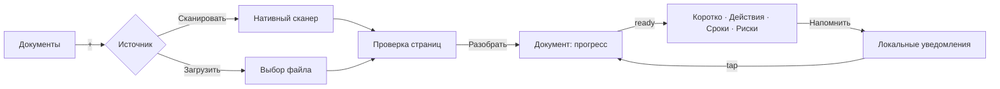
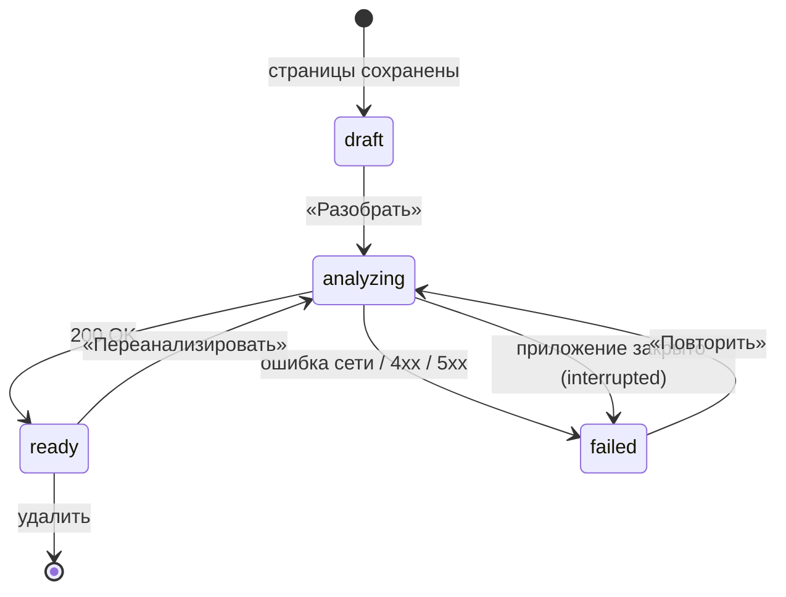
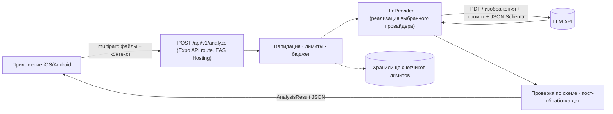

# Навигатор по документам: спецификация MVP

|            |                                                                      |
| ---------- | -------------------------------------------------------------------- |
| Статус     | Черновик v0.1                                                        |
| Дата       | 2026-10-17                                                           |
| Платформы  | iOS, Android (web только для разработки)                             |
| Стек       | Expo SDK 58, React Native 0.88, Expo Router, React Query, TypeScript |
| План работ | [IMPLEMENTATION_PLAN.md](./IMPLEMENTATION_PLAN.md)                   |

## 1. Продукт

### 1.1. Идея

Пользователь фотографирует письмо, счёт или договор либо загружает PDF. Приложение простым языком объясняет, что написано в документе, подсвечивает риски, выделяет сроки и напоминает о важных действиях.

### 1.2. Проблема

Официальные письма, счета и договоры пишут сложным языком, часто на чужом для читателя языке. Человек не понимает, что от него хотят, пропускает срок оплаты или ответа и получает штраф, пеню, автопродление договора или судебное взыскание.

### 1.3. Целевая аудитория

- Люди, которые получают документы на неродном языке: эмигранты, экспаты, студенты за границей.
- Те, кому тяжело разбираться в бюрократии: пожилые люди и их родственники.
- Все, кто хочет не пропускать сроки по счетам, договорам и письмам от ведомств.

### 1.4. Ценность в одной фразе

За 30 секунд ответить на четыре вопроса: **что это за документ, что мне нужно сделать, до какого числа и чем я рискую.**

### 1.5. Принятые решения

| Вопрос              | Решение для MVP                                                                                                                            |
| ------------------- | ------------------------------------------------------------------------------------------------------------------------------------------ |
| Хранение            | Только на устройстве (SQLite и файловая система). Аккаунта нет, но модель данных сразу готова к будущей синхронизации.                     |
| Языки               | Документ может быть на любом языке. Объяснение даётся на языке интерфейса. Интерфейс на русском и английском.                              |
| AI-анализ           | Свой бэкенд, LLM-провайдер за абстракцией `LlmProvider`. Провайдера выбираем по итогам сравнения на тестовом наборе документов (см. §7.6). |
| Бэкенд              | Expo API routes (`+api.ts`) в этом репозитории, деплой на EAS Hosting.                                                                     |
| Хранение на сервере | Сервер не сохраняет документы и результаты анализа: обработал запрос и забыл.                                                              |
| Напоминания         | Локальные уведомления (без push-сервера) и кнопка «Добавить в календарь».                                                                  |
| Монетизация         | Бесплатно, с дневным лимитом анализов на устройство и общим бюджетным потолком на сервере.                                                 |
| Платформы           | iOS и Android. Web работает только для разработки: без сканера, уведомлений и календаря.                                                   |

### 1.6. Чего нет в MVP

Аккаунты и синхронизация, чат с вопросами по документу, генерация ответных писем, «Поделиться» и «Открыть в…» из других приложений, пересылка писем по email, папки и семейный доступ, офлайн-анализ, блокировка по Face ID, платная подписка, публичная web-версия. Подробнее в §12.

## 2. Глоссарий

| Термин            | Значение                                                                                                          |
| ----------------- | ----------------------------------------------------------------------------------------------------------------- |
| Документ          | Одна сущность в приложении: письмо, счёт, договор и т. п. Состоит из одной или нескольких страниц или одного PDF. |
| Страница          | Изображение (скан или фото) или страница PDF.                                                                     |
| Анализ            | Структурированный результат, который вернул бэкенд: резюме, риски, сроки, действия, ключевые данные.              |
| Срок (deadline)   | Дата, к которой нужно что-то сделать: оплатить, ответить, расторгнуть, прийти.                                    |
| Действие (action) | Конкретный шаг для пользователя («Оплатить 84,20 € до 31.10»). Может быть связан со сроком.                       |
| Риск              | Последствие бездействия или подвох в документе (пеня, автопродление, штраф, односторонние изменения условий).     |
| Напоминание       | Локальное уведомление, запланированное относительно срока.                                                        |

## 3. Пользовательские сценарии

| ID    | Как пользователь, я хочу…                                              | Чтобы…                                                           |
| ----- | ---------------------------------------------------------------------- | ---------------------------------------------------------------- |
| US-1  | отсканировать бумажный документ из нескольких страниц камерой телефона | не искать сканер и получить ровные, обрезанные по краям страницы |
| US-2  | загрузить PDF или фото из файлов телефона                              | разобрать документ, который пришёл по почте или в мессенджере    |
| US-3  | получить краткое объяснение простым языком на своём языке              | понять суть документа, не читая его целиком                      |
| US-4  | видеть сроки и действия с датами                                       | знать, что и когда нужно сделать                                 |
| US-5  | видеть риски с объяснением и цитатой из оригинала                      | понимать, чем грозит бездействие, и иметь возможность проверить  |
| US-6  | получить напоминание за несколько дней до срока                        | не пропустить оплату или ответ                                   |
| US-7  | добавить срок в системный календарь                                    | держать все дела в одном месте                                   |
| US-8  | исправить дату срока, если приложение ошиблось                         | доверять напоминаниям                                            |
| US-9  | отметить действие выполненным                                          | убрать его из списка «Требует внимания» и отменить напоминания   |
| US-10 | найти старый документ по названию, отправителю или содержанию          | быстро вернуться к нему                                          |
| US-11 | удалить документ или все данные                                        | контролировать свои данные                                       |

## 4. Функциональные требования

Приоритеты: **M** — обязательно для MVP, **S** — желательно, **C** — если останется время.

### 4.1. Захват документа (CAP)

| ID     | Требование                                                                                                                                                                                                                                                         | Приоритет |
| ------ | ------------------------------------------------------------------------------------------------------------------------------------------------------------------------------------------------------------------------------------------------------------------ | --------- |
| CAP-1  | Кнопка «+» на главном экране открывает выбор источника: «Сканировать» или «Загрузить файл».                                                                                                                                                                        | M         |
| CAP-2  | Сканер использует нативный сканер ОС: VisionKit на iOS, ML Kit Document Scanner на Android. Он сам находит края, исправляет перспективу и снимает несколько страниц подряд. Кандидат на обёртку: `react-native-document-scanner-plugin` (есть Expo config plugin). | M         |
| CAP-3  | Загрузка файла через `expo-document-picker`. Типы: `application/pdf`, `image/jpeg`, `image/png`, `image/heic`. Один файл за раз.                                                                                                                                   | M         |
| CAP-4  | Перед сохранением изображения нормализуются через `expo-image-manipulator`: JPEG, длинная сторона не больше 2048 px, качество 0.8, HEIC конвертируется в JPEG.                                                                                                     | M         |
| CAP-5  | Экран проверки после сканирования: миниатюры страниц, удаление страницы, «Доснять ещё», кнопка «Разобрать документ».                                                                                                                                               | M         |
| CAP-6  | Изменение порядка страниц перетаскиванием.                                                                                                                                                                                                                         | S         |
| CAP-7  | Лимиты: до 30 страниц и до 20 МБ на документ. При превышении показываем понятную ошибку до отправки. Лимиты задаются в одном месте и совпадают с серверными.                                                                                                       | M         |
| CAP-8  | PDF с паролем или повреждённый PDF: понятная ошибка («Файл защищён паролем, откройте его и сохраните копию без пароля»).                                                                                                                                           | M         |
| CAP-9  | Если на Android нет Google Play Services и ML Kit недоступен, предлагаем загрузить фото из галереи или файлов.                                                                                                                                                     | S         |
| CAP-10 | На web кнопки «Сканировать» нет, доступна только загрузка файла.                                                                                                                                                                                                   | M         |

### 4.2. Хранение (STO)

| ID    | Требование                                                                                                                                       | Приоритет |
| ----- | ------------------------------------------------------------------------------------------------------------------------------------------------ | --------- |
| STO-1 | Метаданные, результаты анализа, сроки и действия хранятся в SQLite (`expo-sqlite`). Схема в §6.                                                  | M         |
| STO-2 | Файлы страниц лежат в `Paths.document/documents/<documentId>/` (`expo-file-system`). Кэш-директорию не используем: система может её очистить.    | M         |
| STO-3 | В БД хранятся **относительные** пути к файлам. На iOS абсолютный путь к контейнеру приложения меняется между обновлениями.                       | M         |
| STO-4 | Модель данных готова к синхронизации: идентификаторы UUID v4, поля `createdAt`, `updatedAt` и `deletedAt` (мягкое удаление) у всех сущностей.    | M         |
| STO-5 | Схема версионируется, миграции выполняются при старте приложения.                                                                                | M         |
| STO-6 | При удалении документа удаляются его файлы и отменяются его напоминания. Записи в БД помечаются `deletedAt` и физически удаляются через 30 дней. | M         |
| STO-7 | В настройках есть «Удалить все данные»: БД, файлы, запланированные уведомления.                                                                  | M         |

### 4.3. Анализ (ANL)

| ID     | Требование                                                                                                                                                                                           | Приоритет |
| ------ | ---------------------------------------------------------------------------------------------------------------------------------------------------------------------------------------------------- | --------- |
| ANL-1  | Анализ запускается кнопкой «Разобрать документ». Клиент отправляет страницы (или PDF) на `POST /api/v1/analyze`, контракт в §7.                                                                      | M         |
| ANL-2  | У документа есть статус: `draft` → `analyzing` → `ready` или `failed`. Переходы показаны в §6.3.                                                                                                     | M         |
| ANL-3  | Во время анализа экран документа показывает прогресс («Читаем документ…», «Ищем сроки…»), а пользователь может уйти на другие экраны. Результат сохраняется, даже если пользователь ушёл.            | M         |
| ANL-4  | Если приложение закрыли во время анализа, при следующем запуске такой документ получает статус `failed` с причиной «прервано» и кнопкой «Повторить».                                                 | M         |
| ANL-5  | Объяснение приходит на языке интерфейса. Клиент передаёт язык, сегодняшнюю дату и часовой пояс, чтобы относительные сроки («в течение 14 дней») считались правильно.                                 | M         |
| ANL-6  | У каждого срока и риска есть цитата из оригинала (`sourceQuote`), чтобы пользователь мог проверить. Сроки, вычисленные моделью, помечены «Рассчитано: …» и предупреждением «Проверьте по оригиналу». | M         |
| ANL-7  | Если документ нечитаем или это не документ, анализ возвращает `quality.readable = false` и список проблем. Приложение предлагает переснять.                                                          | M         |
| ANL-8  | «Переанализировать» перезаписывает результат анализа. Сроки, которые пользователь исправил вручную, сохраняются. Перед перезаписью приложение просит подтверждение.                                  | S         |
| ANL-9  | Ошибки сети, лимитов и сервера показываются понятным текстом и кнопкой «Повторить». При `429` приложение показывает, когда лимит обновится.                                                          | M         |
| ANL-10 | Без сети анализ не запускается, черновик сохраняется. Автоматический запуск при появлении сети: уровень C.                                                                                           | M / C     |

### 4.4. Экран документа (DET)

Порядок блоков отвечает на четыре вопроса из §1.4.

| ID    | Блок                                                                                                                                                                                 | Приоритет |
| ----- | ------------------------------------------------------------------------------------------------------------------------------------------------------------------------------------ | --------- |
| DET-1 | Заголовок: короткое название («Счёт за электричество, сентябрь 2026»), тип, отправитель, дата документа.                                                                             | M         |
| DET-2 | «Коротко»: 2–4 предложения простым языком.                                                                                                                                           | M         |
| DET-3 | «Что нужно сделать»: действия с датами и чекбоксом «Сделано». Ближайшие сверху.                                                                                                      | M         |
| DET-4 | «Сроки»: дата, что произойдёт, кнопки «Напомнить», «В календарь», «Изменить дату».                                                                                                   | M         |
| DET-5 | «Риски»: уровень (высокий, средний, низкий), обозначенный и текстом, и иконкой (не только цветом). Объяснение и цитата из оригинала, раскрывается по нажатию.                        | M         |
| DET-6 | «Ключевые данные»: суммы, номера договоров и дел, IBAN, периоды, контакты. Значение копируется долгим нажатием.                                                                      | M         |
| DET-7 | «Оригинал»: миниатюры страниц и полноэкранный просмотр изображений. PDF открывается через системное меню «Открыть в…» (`expo-sharing`). Просмотр PDF внутри приложения будет в v1.1. | M         |
| DET-8 | Внизу дисклеймер: «Это не юридическая консультация. Проверяйте важные даты и суммы по оригиналу документа».                                                                          | M         |
| DET-9 | Меню: «Переименовать», «Переанализировать», «Удалить».                                                                                                                               | M         |

### 4.5. Главный экран и поиск (HOME)

| ID     | Требование                                                                                                                                | Приоритет |
| ------ | ----------------------------------------------------------------------------------------------------------------------------------------- | --------- |
| HOME-1 | Вкладка «Документы». Вверху блок «Требует внимания»: открытые сроки в ближайшие 14 дней, просроченные сроки и документы с высоким риском. | M         |
| HOME-2 | Ниже список всех документов, новые сверху. В карточке: название, тип, отправитель, ближайший срок, статус анализа.                        | M         |
| HOME-3 | Поиск по названию, отправителю, резюме и ключевым данным (SQL `LIKE`; FTS5 — уровень C).                                                  | M         |
| HOME-4 | Фильтр по типу документа.                                                                                                                 | S         |
| HOME-5 | Пустой экран с объяснением и большой кнопкой «Сканировать документ».                                                                      | M         |

### 4.6. Сроки и напоминания (REM)

| ID     | Требование                                                                                                                                                                                                     | Приоритет |
| ------ | -------------------------------------------------------------------------------------------------------------------------------------------------------------------------------------------------------------- | --------- |
| REM-1  | Вкладка «Сроки»: хронологический список открытых сроков из всех документов с группами «Просрочено», «На этой неделе», «Позже».                                                                                 | M         |
| REM-2  | Для каждого найденного срока приложение предлагает напоминания по умолчанию: за 7 дней, за 1 день и в день срока в 09:00 по местному времени. Напоминания в прошлом пропускаются.                              | M         |
| REM-3  | Пользователь может выключить напоминания для срока или выбрать другие смещения. Значения по умолчанию задаются в настройках.                                                                                   | M         |
| REM-4  | Уведомления локальные (`expo-notifications`, триггер `DATE`). Android-канал `deadlines` создаётся при первом запуске.                                                                                          | M         |
| REM-5  | Разрешение на уведомления запрашивается в момент, когда оно нужно (первое включение напоминания), а не при запуске. Если пользователь отказал, показываем объяснение и ссылку в системные настройки.           | M         |
| REM-6  | Нажатие на уведомление открывает документ (deep link `documentnavigatorapp://documents/<id>`).                                                                                                                 | M         |
| REM-7  | Планирование идемпотентно: одна функция `syncReminders()` сверяет желаемые напоминания из БД с запланированными в ОС. Она вызывается после любого изменения сроков и при возврате приложения на передний план. | M         |
| REM-8  | iOS держит не больше 64 запланированных уведомлений. Планируем ближайшие 60, остальные дозапланирует `syncReminders()`.                                                                                        | M         |
| REM-9  | «Сделано» или удаление документа отменяет напоминания по сроку.                                                                                                                                                | M         |
| REM-10 | «В календарь» открывает системную форму события через `expo-calendar` (`addEventWithForm`). На iOS нужен доступ только на запись, на Android разрешение не требуется.                                          | M         |
| REM-11 | Точные будильники (exact alarms) на Android не нужны: допустима погрешность в несколько минут.                                                                                                                 | M         |

### 4.7. Онбординг и согласие (ONB)

| ID    | Требование                                                                                                                                                                                                                   | Приоритет |
| ----- | ---------------------------------------------------------------------------------------------------------------------------------------------------------------------------------------------------------------------------- | --------- |
| ONB-1 | 2–3 экрана при первом запуске: что умеет приложение, как работает анализ, дисклеймер.                                                                                                                                        | M         |
| ONB-2 | Перед первым анализом пользователь явно соглашается: «Документ отправляется на наш сервер и AI-провайдеру для анализа. Мы его не сохраняем». Здесь же ссылка на политику конфиденциальности. Без согласия анализ недоступен. | M         |

### 4.8. Настройки (SET)

| ID    | Требование                                                                                     | Приоритет |
| ----- | ---------------------------------------------------------------------------------------------- | --------- |
| SET-1 | Язык интерфейса и объяснений: системный, русский или английский.                               | M         |
| SET-2 | Напоминания по умолчанию: смещения и время.                                                    | M         |
| SET-3 | «Удалить все данные» с подтверждением.                                                         | M         |
| SET-4 | Политика конфиденциальности, дисклеймер, версия приложения, оставшийся дневной лимит анализов. | M         |

## 5. Экраны и навигация

```
src/app/
  _layout.tsx                 Stack + AppProviders; редирект на онбординг при первом запуске
  (tabs)/
    _layout.tsx               NativeTabs: Документы · Сроки · Настройки
    index.tsx                 Документы: «Требует внимания» + список + поиск
    deadlines.tsx             Сроки: хронология
    settings.tsx              Настройки
  capture/
    index.tsx                 modal: выбор источника (Сканировать / Загрузить)
    review.tsx                modal: проверка страниц → «Разобрать документ»
  documents/
    [id].tsx                  документ: анализ / прогресс / ошибка
    [id]/pages.tsx            полноэкранный просмотр страниц
  onboarding.tsx              modal, fullScreen
  api/v1/
    analyze+api.ts            POST — анализ (серверный код)
    limits+api.ts             GET — остаток лимита для устройства
```

Маршруты остаются тонкими: читают параметры и рендерят экран из `src/features/*/screens/`. Новая вкладка требует триггера и в `src/components/app-tabs.tsx`, и в `src/components/app-tabs.web.tsx`.

Основной сценарий:



## 6. Модель данных (клиент)

### 6.1. Типы

```ts
type DocumentStatus = 'draft' | 'analyzing' | 'ready' | 'failed';
type DocumentSource = 'scan' | 'upload';

type DocumentRecord = {
  id: string; // UUID v4
  title: string; // из анализа, пользователь может переименовать
  documentType: DocumentType | null;
  senderName: string | null;
  documentDate: string | null; // YYYY-MM-DD
  status: DocumentStatus;
  errorCode: AnalyzeErrorCode | 'interrupted' | null;
  source: DocumentSource;
  mimeType: 'application/pdf' | 'image/jpeg';
  pageCount: number;
  fileSize: number; // байты, сумма по страницам
  analysis: AnalysisResult | null; // JSON, см. §7.3
  analysisLocale: string | null; // язык, на котором получено объяснение
  analyzedAt: string | null; // ISO 8601
  createdAt: string;
  updatedAt: string;
  deletedAt: string | null;
};

type PageRecord = {
  id: string;
  documentId: string;
  index: number; // 0-based
  relativePath: string; // относительно Paths.document
  width: number | null;
  height: number | null;
};

type DeadlineRecord = {
  id: string;
  documentId: string;
  kind: DeadlineKind;
  description: string;
  dueDate: string; // YYYY-MM-DD, календарная дата без часового пояса
  dueTime: string | null; // HH:mm, если указано в документе
  dateSource: 'explicit' | 'computed' | 'user';
  confidence: 'high' | 'medium' | 'low';
  status: 'open' | 'done' | 'dismissed';
  reminderOffsetsDays: number[] | null; // null — по умолчанию из настроек, [] — выключено
  userEdited: boolean;
  createdAt: string;
  updatedAt: string;
  deletedAt: string | null;
};

type ActionRecord = {
  id: string;
  documentId: string;
  deadlineId: string | null;
  description: string;
  priority: 'high' | 'medium' | 'low';
  done: boolean;
  createdAt: string;
  updatedAt: string;
  deletedAt: string | null;
};
```

Риски и ключевые данные только читаются, поэтому живут внутри `analysis`. Сроки и действия пользователь редактирует и по ним планируются уведомления, поэтому они нормализованы в отдельные таблицы.

### 6.2. Таблицы SQLite

| Таблица                   | Назначение                                                                        |
| ------------------------- | --------------------------------------------------------------------------------- |
| `documents`               | `DocumentRecord`, поле `analysis` хранится как `TEXT` с JSON                      |
| `pages`                   | `PageRecord`, индекс по `(document_id, index)`                                    |
| `deadlines`               | `DeadlineRecord`, индекс по `(status, due_date)`                                  |
| `actions`                 | `ActionRecord`                                                                    |
| `scheduled_notifications` | `deadline_id`, `fire_at`, `notification_id` из ОС, для сверки в `syncReminders()` |
| `settings`                | ключ–значение: язык, напоминания по умолчанию, флаги онбординга и согласия        |
| `schema_migrations`       | версия схемы                                                                      |

Идентификатор устройства (`deviceId`, UUID v4) создаётся при первом запуске и хранится в `expo-secure-store`. На iOS Keychain переживает переустановку, это немного усложняет обход лимитов.

### 6.3. Статусы документа



## 7. Бэкенд анализа

### 7.1. Архитектура



- Серверный код живёт в `src/server/**` и импортируется **только** из файлов `src/app/api/**/*+api.ts`. Это закрепляется правилом ESLint `no-restricted-imports`. Секреты (ключ LLM) читаются только там, в клиентский бандл они не попадают.
- Общие для клиента и сервера типы и схема ответа лежат в `src/shared/analysis/` (тип и runtime-валидатор из одного источника).
- Сервер ничего не сохраняет. В логи попадают только метаданные: хэш `deviceId`, число страниц, размер, задержка, токены, стоимость, код ошибки. Содержимое документов и ответы модели не логируются.
- Ограничения среды: EAS Hosting работает на Cloudflare Workers (WinterCG). Всё бандлится в один файл, нативные бинарные зависимости вроде `sharp` недоступны, `fs` работает в памяти. Поэтому PDF на сервере не рендерится в картинки: модель должна принимать PDF напрямую (§7.5).

### 7.2. API

**`POST /api/v1/analyze`** — `multipart/form-data`

| Поле       | Тип    | Описание                                                               |
| ---------- | ------ | ---------------------------------------------------------------------- |
| `files`    | File[] | Либо один `application/pdf`, либо 1–30 `image/jpeg` по порядку страниц |
| `locale`   | string | Язык объяснения, BCP-47 (`ru`, `en`)                                   |
| `today`    | string | Сегодняшняя дата на устройстве, `YYYY-MM-DD`                           |
| `timezone` | string | IANA, например `Europe/Berlin`                                         |

Заголовки: `X-Device-Id`, `X-App-Version`, `X-Platform`. После этапа защиты добавится `X-Integrity-Token` (см. §8.3).

Ответ `200`: `AnalysisResult` (§7.3).

Ошибки (тело `{ "error": { "code": string, "message": string } }`):

| HTTP | `code`            | Когда                                                      |
| ---- | ----------------- | ---------------------------------------------------------- |
| 400  | `invalid_request` | нет файлов, неверный тип, смесь PDF и изображений          |
| 413  | `too_large`       | больше 20 МБ или 30 страниц                                |
| 422  | `encrypted_pdf`   | PDF защищён паролем                                        |
| 429  | `rate_limited`    | исчерпан дневной лимит устройства; заголовок `Retry-After` |
| 502  | `analysis_failed` | модель вернула невалидный ответ после повторной попытки    |
| 503  | `unavailable`     | провайдер недоступен или исчерпан общий бюджет             |

**`GET /api/v1/limits`** → `{ "dailyLimit": 10, "remaining": 7, "resetsAt": "2026-10-18T00:00:00Z" }`

Запрос синхронный, клиентский таймаут 90 секунд. Если на этапе 0 выяснится, что EAS Hosting не держит такие запросы, есть запасные варианты: потоковый ответ с прогрессом или асинхронная задача с временным хранилищем и TTL (см. риски в плане).

### 7.3. Схема результата анализа

```ts
type DocumentType =
  | 'letter' // письмо
  | 'invoice' // счёт
  | 'contract' // договор
  | 'official_notice' // письмо от ведомства, уведомление
  | 'fine' // штраф
  | 'tax' // налоги
  | 'insurance'
  | 'bank'
  | 'medical'
  | 'other'
  | 'unknown';

type DeadlineKind =
  | 'payment' // оплатить
  | 'response' // ответить, возразить, обжаловать
  | 'submission' // подать документы
  | 'appointment' // прийти на приём
  | 'cancellation' // последний день расторжения
  | 'renewal' // автопродление
  | 'other';

type AnalysisResult = {
  schemaVersion: 1;
  documentType: DocumentType;
  title: string; // короткое название на языке объяснения
  documentLanguage: string; // язык оригинала, BCP-47
  sender: { name: string; kind: 'government' | 'company' | 'individual' | 'unknown' } | null;
  documentDate: string | null; // YYYY-MM-DD
  summary: string; // 2–4 предложения простым языком
  actions: {
    id: string; // стабильный в пределах ответа, для связи со сроками
    description: string;
    priority: 'high' | 'medium' | 'low';
    deadlineId: string | null;
  }[];
  deadlines: {
    id: string;
    kind: DeadlineKind;
    description: string; // что нужно сделать к этой дате
    date: string; // YYYY-MM-DD
    time: string | null; // HH:mm
    dateSource: 'explicit' | 'computed';
    computation: string | null; // для computed: «14 дней с даты письма 03.10.2026»
    sourceQuote: string; // дословная цитата из оригинала
    page: number | null; // 1-based
    confidence: 'high' | 'medium' | 'low';
  }[];
  risks: {
    severity: 'high' | 'medium' | 'low';
    title: string;
    explanation: string; // что будет, если ничего не делать, или в чём подвох
    sourceQuote: string | null;
    page: number | null;
  }[];
  keyFacts: {
    kind: 'amount' | 'reference' | 'account' | 'period' | 'contact' | 'other';
    label: string; // «Сумма к оплате», «Номер договора»
    value: string; // как в документе: «84,20 €», «DE89 3704 0044 0532 0130 00»
  }[];
  quality: {
    readable: boolean;
    issues: ('blurry' | 'cropped' | 'dark' | 'not_a_document' | 'partial' | 'handwritten')[];
  };
};
```

Все тексты, кроме `sourceQuote` и `keyFacts[].value`, приходят на языке `locale`. Цитаты и значения остаются на языке оригинала.

### 7.4. Правила анализа (основа промпта)

1. Не выдумывать. Если сроков нет, `deadlines` пустой. Если сумма не указана, её нет в `keyFacts`.
2. Каждый срок и каждый риск, где это возможно, подкрепляется дословной цитатой и номером страницы.
3. Относительные сроки («в течение двух недель с даты получения») вычисляются от `documentDate`, а если её нет, то от `today`. Результат помечается `dateSource: 'computed'` с объяснением в `computation` и `confidence` не выше `medium`.
4. Уровень риска определяется по рубрике. **high**: деньги, суд, взыскание, потеря прав или жилья, штраф, срок меньше 14 дней. **medium**: автопродление, пеня, изменение условий. **low**: информационное.
5. Типичные риски по типам документов. Договор: автопродление, срок уведомления о расторжении, штрафные санкции, односторонние изменения, скрытые платежи. Счёт: просрочка, необычная сумма, прямое списание. Письмо от ведомства: последствия пропуска срока, сроки обжалования.
6. Простой язык: короткие предложения, без канцелярита, термины объясняются.
7. Не давать юридических советов сверх описания того, что написано и что делать по тексту документа.
8. Нечитаемая страница или не документ: `quality.readable = false`, остальные поля минимальны.

Сервер дополнительно проверяет ответ:

- Ответ проходит валидацию по схеме. При ошибке делается одна повторная попытка с текстом ошибки, затем возвращается `502`.
- Даты имеют корректный формат и попадают в диапазон от `documentDate − 1 год` до `today + 10 лет`. Остальные отбрасываются.
- `deadlineId` в действиях ссылается на существующий срок.

### 7.5. Требования к LLM-провайдеру

| Требование                                                                                | Почему                                                           |
| ----------------------------------------------------------------------------------------- | ---------------------------------------------------------------- |
| Нативный приём PDF и изображений (vision)                                                 | На EAS Hosting нельзя растеризовать PDF. Отдельный OCR не нужен. |
| Structured output или JSON Schema                                                         | Надёжный разбор ответа                                           |
| Контекст не меньше 30 страниц документа                                                   | Договоры бывают длинными                                         |
| Хорошее качество на ru, en, de, uk и других европейских языках                            | Основной сценарий: документ на чужом языке                       |
| Данные не используются для обучения, минимальное хранение (zero retention, если доступно) | Конфиденциальность. Это обещание пользователю (ONB-2).           |
| Обработка данных в ЕС или наличие DPA                                                     | GDPR, если запуск в ЕС (открытый вопрос)                         |
| p95 задержки ≤ 30 с на документ из 3 страниц                                              | UX                                                               |
| Предсказуемая стоимость документа                                                         | Бесплатная модель с лимитами                                     |

Интерфейс:

```ts
interface LlmProvider {
  readonly id: string; // 'mock' | '<provider>-<model>'
  analyze(input: {
    files: { mimeType: string; bytes: Uint8Array }[];
    locale: string;
    today: string;
    timezone: string;
    signal?: AbortSignal;
  }): Promise<{ result: unknown; usage: { inputTokens: number; outputTokens: number } }>;
}
```

`MockLlmProvider` возвращает фикстуры. Он используется в тестах и в разработке без ключа: включается, если не задана переменная окружения `LLM_PROVIDER`.

### 7.6. Оценка качества

- Тестовый набор из 30–50 документов: письма, счета, договоры на ru, en и de, разное качество фото (ровный скан, фото под углом, плохой свет). **Реальные документы с персональными данными в репозиторий не кладём:** только синтетические или обезличенные, либо хранилище вне git.
- Для каждого документа вручную размечены эталонные сроки (дата и тип) и ключевые риски.
- Метрики и пороги для выбора провайдера:
  - полнота сроков ≥ 90%;
  - точность дат ≥ 95%;
  - выдуманных сроков — 0;
  - p95 задержки ≤ 30 с;
  - стоимость документа.
- Скрипт оценки (`scripts/eval/`) запускает набор через любую реализацию `LlmProvider` и выводит отчёт. Его прогоняют при смене модели или промпта.

## 8. Нефункциональные требования

### 8.1. Производительность

- От нажатия «Разобрать» до результата для документа из 3 страниц: p50 ≤ 20 с, p95 ≤ 45 с.
- Главный экран со 100+ документами прокручивается без пропуска кадров (виртуализированный список).
- Холодный старт до интерактивного главного экрана ≤ 2 с на устройстве среднего уровня.

### 8.2. Конфиденциальность и безопасность

- Документы хранятся только в песочнице приложения. На сервер они уходят только для анализа по TLS, сервер их не сохраняет.
- Ключ LLM и прочие секреты живут только на сервере (переменные окружения EAS Hosting). В клиенте только `EXPO_PUBLIC_*`, и читаются они через `src/lib/env.ts`.
- Политика конфиденциальности и App Privacy / Data safety в сторах описывают передачу документа AI-провайдеру.
- Блокировка приложения по Face ID или отпечатку отложена (§12).

### 8.3. Защита бэкенда и лимиты

- Дневной лимит на `deviceId` (предложение: 10 анализов в день) и ограничение частоты по IP.
- Общий дневной бюджет на LLM. При превышении сервер отвечает `503 unavailable`. Дополнительно настраивается лимит расходов в кабинете провайдера.
- Счётчикам нужно внешнее хранилище, доступное из Workers по HTTP (например, Redis-совместимое serverless KV). Выбор на этапе 3.
- Перед публичным релизом подключается `@expo/app-integrity` (App Attest и Play Integrity), чтобы запросы принимались только от настоящего приложения. Модуль в статусе alpha, API может меняться.

### 8.4. Доступность

- Роли и подписи для VoiceOver и TalkBack у всех интерактивных элементов, заголовки с `role="heading"`.
- Зоны нажатия ≥ 44 pt, поддержка крупного шрифта, контраст AA в светлой и тёмной теме.
- Уровень риска обозначается текстом и иконкой, а не только цветом.

### 8.5. Локализация

- Интерфейс на `ru` и `en`. Язык по умолчанию определяется через `expo-localization`.
- Даты и суммы форматируются через `Intl` в локали пользователя.
- Все строки интерфейса вынесены в словари, включая существующие английские строки шаблона.

### 8.6. Надёжность и наблюдаемость

- Сервер пишет метрики: задержку, токены, стоимость, коды ошибок, долю невалидных ответов модели.
- Crash reporting на клиенте (Sentry или аналог) — открытый вопрос (§11).

## 9. Платформенные особенности и ограничения

| Тема                       | Что учесть                                                                                                                                                |
| -------------------------- | --------------------------------------------------------------------------------------------------------------------------------------------------------- |
| Expo Go                    | Сканер и календарь в Expo Go не работают. Нужен development build (`npx expo run:android` или `run:ios` локально либо `eas build --profile development`). |
| iOS-сканер                 | VisionKit, нужен `NSCameraUsageDescription` (задаётся через config plugin).                                                                               |
| Android-сканер             | ML Kit Document Scanner работает через Google Play Services. На устройствах без GMS сканер недоступен (CAP-9).                                            |
| Уведомления iOS            | Лимит 64 запланированных уведомления (REM-8).                                                                                                             |
| Уведомления Android 13+    | Runtime-разрешение. Запрос не появится, пока не создан хотя бы один канал.                                                                                |
| Календарь iOS 17+          | Достаточно доступа только на запись (`writeOnlyAccess` в config plugin).                                                                                  |
| Web                        | Только для разработки: нет сканера, уведомлений и календаря. Для этих модулей нужны `.web.ts`-заглушки.                                                   |
| Linux-окружение разработки | Сборки и поведение под iOS здесь проверить нельзя, только через EAS Build или Mac.                                                                        |

## 10. Новые зависимости (требуют подтверждения)

| Пакет                                                    | Зачем                                                                                               | Нативный код          |
| -------------------------------------------------------- | --------------------------------------------------------------------------------------------------- | --------------------- |
| `react-native-document-scanner-plugin`                   | Сканер (VisionKit и ML Kit). Перед установкой проверить совместимость с New Architecture и RN 0.88. | да                    |
| `expo-document-picker`                                   | Выбор PDF и изображений                                                                             | да (есть в Expo Go)   |
| `expo-file-system`                                       | Хранение файлов страниц                                                                             | да                    |
| `expo-sqlite`                                            | Локальная БД                                                                                        | да                    |
| `expo-image-manipulator`                                 | Сжатие и конвертация изображений                                                                    | да                    |
| `expo-notifications`                                     | Локальные напоминания                                                                               | да                    |
| `expo-calendar`                                          | «Добавить в календарь»                                                                              | да (только dev build) |
| `expo-localization`                                      | Язык устройства                                                                                     | да                    |
| `expo-secure-store`                                      | Хранение `deviceId`                                                                                 | да                    |
| `expo-sharing`                                           | «Открыть в…» для PDF                                                                                | да                    |
| `expo-crypto`                                            | `randomUUID()`                                                                                      | да                    |
| `zod`                                                    | Единая схема ответа: runtime-валидация и JSON Schema для LLM                                        | нет                   |
| Библиотека i18n (`i18next` + `react-i18next` или аналог) | Локализация                                                                                         | нет                   |
| SDK выбранного LLM-провайдера или прямой `fetch`         | Вызов модели (только сервер)                                                                        | нет                   |
| Клиент KV-хранилища для лимитов                          | Счётчики (только сервер)                                                                            | нет                   |
| `@expo/app-integrity` (перед релизом)                    | Аттестация приложения                                                                               | да                    |

Всё, что идёт с SDK Expo, ставится через `npx expo install`. Дата-пикер уже есть в `@expo/ui` (установлен).

## 11. Открытые вопросы

| #   | Вопрос                                                                                        | Предложение по умолчанию                                |
| --- | --------------------------------------------------------------------------------------------- | ------------------------------------------------------- |
| 1   | Название приложения, `ios.bundleIdentifier`, `android.package`                                | Нужны до первой сборки в EAS                            |
| 2   | В каких странах запускаемся? От этого зависят GDPR, регион обработки у LLM и тексты политики. | ЕС и СНГ, обработка в ЕС                                |
| 3   | Размер бесплатного лимита                                                                     | 10 анализов в день, 30 страниц на документ              |
| 4   | Минимальные версии ОС                                                                         | iOS 16+, Android 8+ (API 26)                            |
| 5   | Нужен ли просмотр PDF внутри приложения в MVP?                                                | Нет: системное «Открыть в…», встроенный просмотр в v1.1 |
| 6   | Crash reporting и продуктовая аналитика                                                       | Sentry без PII, аналитика после MVP, с согласием        |
| 7   | Есть ли дизайн или брендбук?                                                                  | Нет: системный стиль и текущие токены темы              |
| 8   | Нужна ли отдельная вкладка «Сроки» или достаточно блока на главном?                           | Отдельная вкладка                                       |
| 9   | Кто размечает тестовый набор документов для оценки качества и откуда берём документы?         | Синтетические и обезличенные, 30–50 штук                |
| 10  | Политика конфиденциальности и юридический текст дисклеймера                                   | Нужен юрист до публичного релиза                        |

## 12. Дорожная карта после MVP

- **v1.1:** «Поделиться» и «Открыть в…» из почты и мессенджеров (share extension или document types), встроенный просмотр PDF, автоповтор анализа при появлении сети, FTS-поиск.
- **v1.2:** аккаунт и синхронизация между устройствами, резервная копия.
- **v1.3:** вопросы по документу (чат), черновик ответного письма или возражения, семейный доступ.
- **Монетизация:** подписка через встроенные покупки при росте затрат на LLM.
